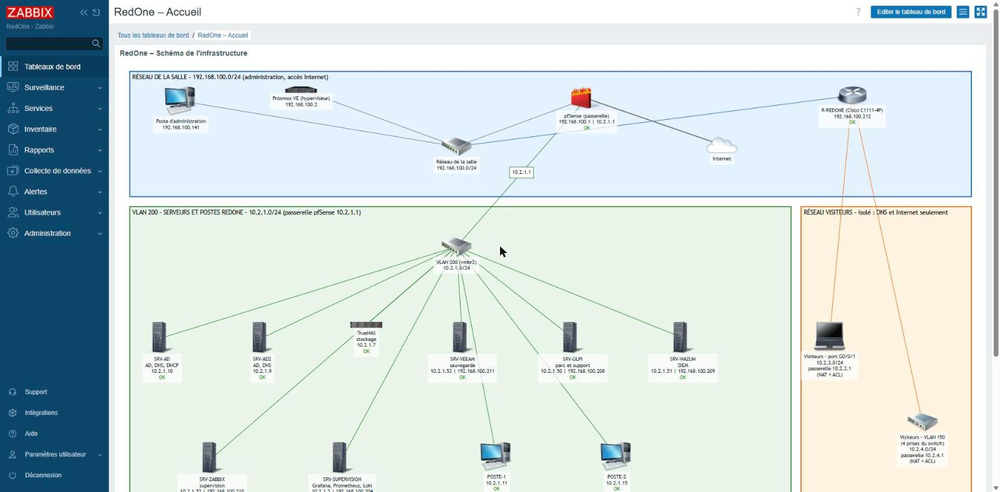
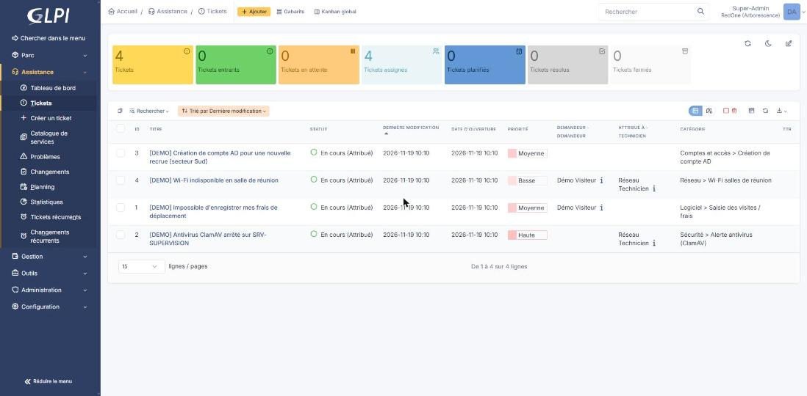
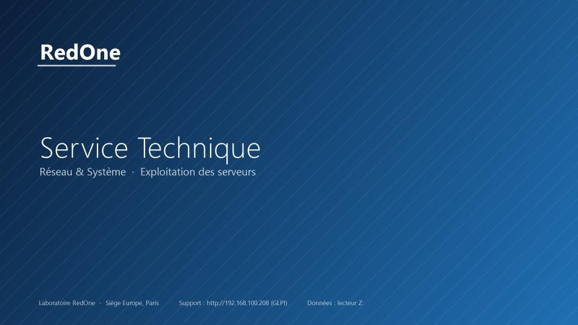
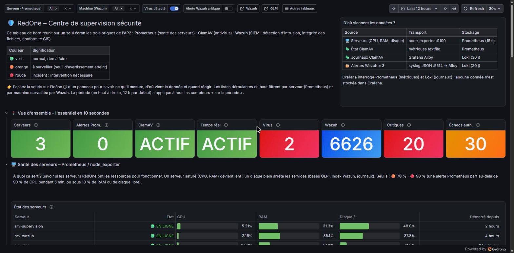
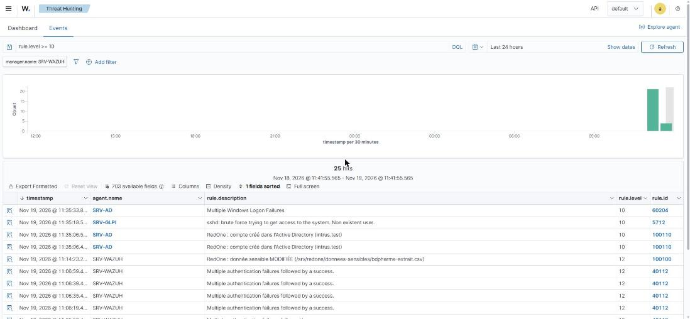
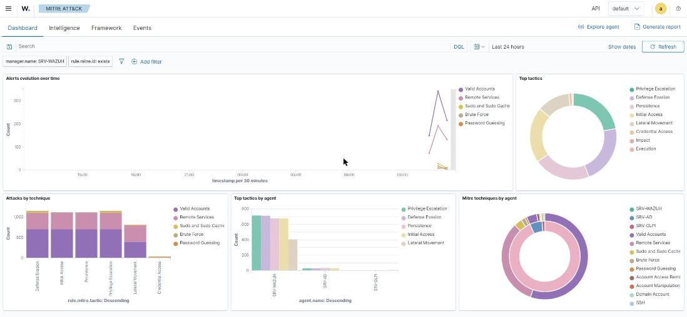
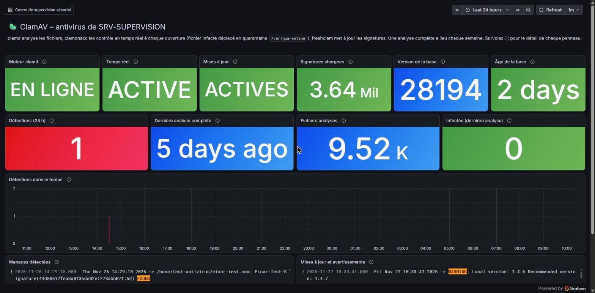
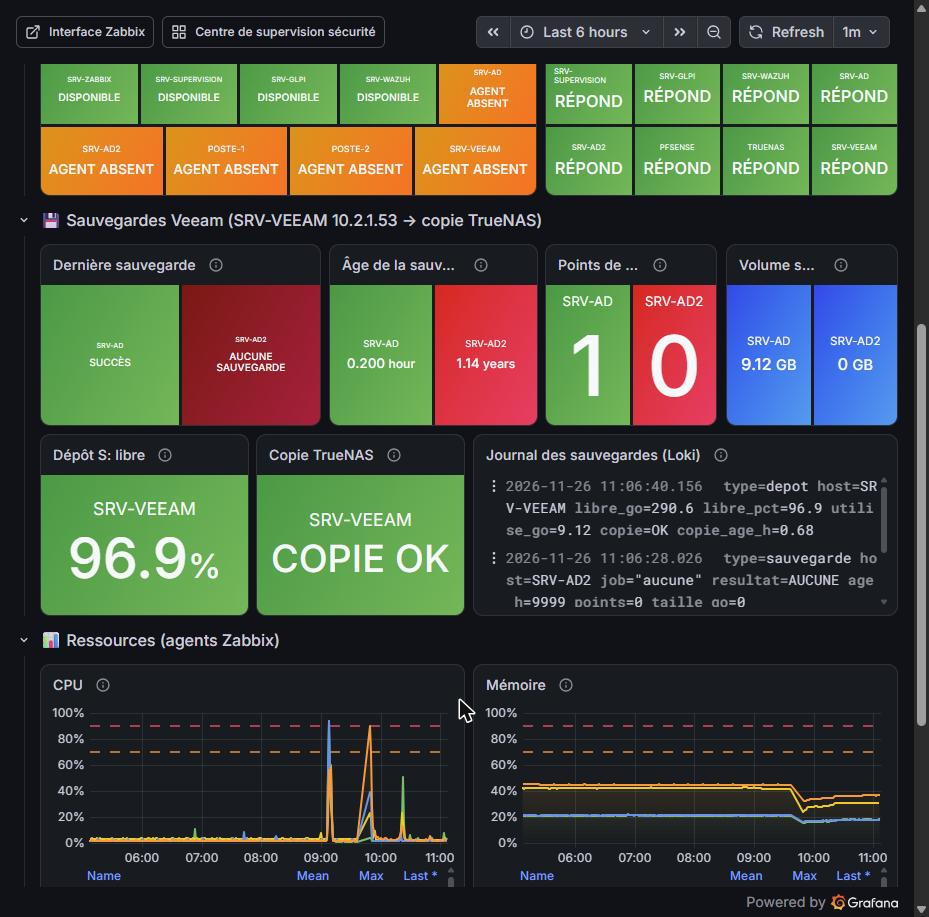
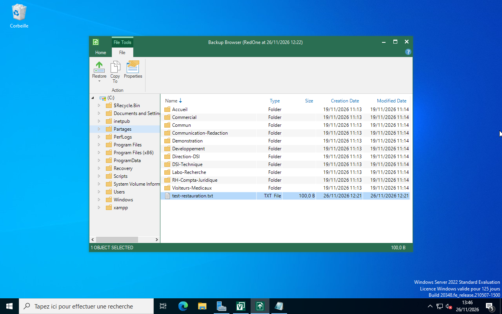

# AP1 – Superviser, contrôler et sécuriser le système d'information

> **Problématique :** *L'infrastructure de RedOne fonctionne : un annuaire, des postes, des partages. Mais fonctionner ne suffit plus. Comment la rendre **maîtrisée**, c'est-à-dire surveillée, protégée, sauvegardée et conforme au RGPD, alors qu'elle héberge des données de santé ?*

**Contexte :** laboratoire pharmaceutique RedOne, site pilote de Paris ([contexte complet](../annexes/Contexte_RedOne.md)). Maquette sur l'hyperviseur Proxmox de la section.

---

## 1. Pourquoi des règles de sécurité sont devenues indispensables

Il y a quelques années, une entreprise pouvait se contenter d'un SI qui « marche ». Ce n'est plus le cas :

- **Les attaques sont devenues industrielles.** Les rançongiciels chiffrent les serveurs et les sauvegardes, puis exigent une rançon ; les hôpitaux et les laboratoires sont des cibles privilégiées, car leurs données sont précieuses et leur activité ne peut pas s'arrêter.
- **La loi impose des obligations.** Le **RGPD** (2018) exige de protéger les données personnelles « par des mesures techniques appropriées » (art. 32), de tracer les accès et de signaler une fuite à la CNIL sous 72 h. Les données de santé de RedOne sont des **données sensibles** (art. 9). La directive européenne **NIS 2** étend en plus les obligations de cybersécurité au secteur de la santé, dont la fabrication de produits pharmaceutiques.
- **Les clients et partenaires demandent des preuves.** Respecter des référentiels reconnus (**guides de l'ANSSI**, **CIS Benchmarks**, **ISO 27001**) permet de montrer, chiffres à l'appui, que le SI est maîtrisé.

Une règle simple résume la démarche : **on ne protège bien que ce que l'on voit.** D'où l'ordre de cet AP : *superviser* → *détecter* → *protéger* → *pouvoir réparer* → *prouver la conformité*.

## 2. Point de départ : une infrastructure de base

| Au départ | Ce qui manquait |
|---|---|
| 1 contrôleur de domaine **SRV-AD** (`RedOne.local`), 2 postes clients, un pfSense commun | aucune vision de l'état des machines |
| des comptes et des partages | aucune détection d'attaque, aucun antivirus centralisé |
| des données de santé sur le serveur | aucune règle de pare-feu sur les machines, mots de passe faibles |
| la sauvegarde de l'entreprise **répliquée aux États-Unis** | aucune sauvegarde locale testée ; transfert de données de santé hors UE |

Il a donc fallu **sophistiquer** cette base. Résultat, l'infrastructure actuelle (page d'accueil de Zabbix, chaque machine colorée selon son état en direct) :



| Machine | Rôle | VLAN 200 (`10.2.1.0/24`) | Administration (`192.168.100.0/24`) |
|---|---|---|---|
| SRV-AD / SRV-AD2 | Active Directory, DNS, DHCP (2 contrôleurs) | `.10` / `.9` | – |
| POSTE-1 / POSTE-2 | postes clients du domaine | `.11` / `.15` | – |
| SRV-GLPI | parc et support | `.50` | `.208` |
| SRV-SUPERVISION | Grafana, Prometheus, Loki, ClamAV | `.3` | `.204` |
| SRV-ZABBIX | supervision | `.52` | `.210` |
| SRV-WAZUH | SIEM (détection d'intrusion) | `.51` | `.209` |
| SRV-VEEAM | sauvegarde | `.53` | `.211` |
| TrueNAS | stockage, 2ᵉ copie des sauvegardes | `.7` | – |

Toutes les adresses ont été **relevées sur les machines elles-mêmes** et comparées au plan et à Zabbix : elles sont conformes.

## 3. Contrôler les identités et le parc

**Active Directory.** Les droits suivent le modèle **AGDLP** : un compte → un groupe global (son rôle) → un groupe domaine local (le droit) → la permission NTFS. Jamais de droit donné directement à un compte.

```powershell
New-ADGroup -Name "GG_Labo-Recherche" -GroupScope Global -Path "OU=Globaux,OU=Groupes,DC=RedOne,DC=local"
Add-ADGroupMember -Identity "DL_Labo-Recherche_RW" -Members "GG_Labo-Recherche"
```

- 12 services, 24 comptes, partage `\\REDONE\Partages` (lecteur Z:) avec **énumération basée sur l'accès** : chacun ne voit que son dossier et le dossier commun. Accès vérifiés compte par compte.
- **GPO** : fond d'écran par rôle, verrouillage de session après 15 min, politique de mots de passe (12 caractères, verrouillage après 10 échecs), message légal avant connexion.
- **2ᵉ contrôleur SRV-AD2** : l'authentification continue si SRV-AD tombe.

**GLPI** gère le parc et les incidents ; il est relié à l'AD (26 comptes importés en LDAP), et les tickets sont attribués automatiquement au bon service.

| | |
|---|---|
|  |  |

Scripts : [`scripts/active-directory/`](scripts/active-directory/), [`scripts/glpi/`](scripts/glpi/).

## 4. Superviser : voir l'état du SI en temps réel

| Outil | Ce qu'il surveille |
|---|---|
| **Zabbix 7.0** | disponibilité (ping, agents), processeur, mémoire, disques, sites web, sauvegardes, routeur ; **déclencheurs** d'alerte par gravité |
| **Prometheus + node_exporter** | métriques système détaillées des serveurs Linux |
| **Grafana** | tableaux de bord qui rassemblent Zabbix, Prometheus et les journaux (Loki) au même endroit |

```bash
# ajout d'un serveur dans Zabbix (agent 2) et vérification
apt install zabbix-agent2 && systemctl enable --now zabbix-agent2
zabbix_get -s 10.2.1.50 -k agent.ping      # → 1
```



Un utilisateur Zabbix **en lecture seule** (authentification par jeton) alimente Grafana : l'outil d'affichage ne peut rien modifier.

## 5. Détecter les attaques : SIEM Wazuh et antivirus

**Wazuh** centralise les journaux de tous les serveurs, les analyse et lève des alertes classées de 0 à 15 (avec la correspondance MITRE ATT&CK).

| Scénario testé | Alerte obtenue |
|---|---|
| 10 connexions SSH avec un compte inexistant | 5712 « brute force » (niveau 10), IP source identifiée |
| modification d'un fichier de données de santé | 550 « intégrité modifiée » (surveillance FIM) |
| force brute puis création d'un compte | **40501** « attaque suivie d'un ajout d'utilisateur » (**niveau 15**, maximum) |
| 8 mots de passe faux sur l'AD | 60204 « échecs de connexion Windows multiples » (niveau 10) |
| création d'un compte dans l'AD | 100110, **règle RedOne** (niveau 10) |
| audit de conformité CIS | score **44 % → 53 %** après durcissement |

| | |
|---|---|
|  |  |

**Réponse active** : Wazuh ne se contente plus de détecter, il **bloque**. Une force brute SSH déclenche le script [`redone-nft-drop`](scripts/wazuh/redone-nft-drop), qui ajoute l'IP de l'attaquant dans le pare-feu nftables du serveur visé pendant 10 minutes.

```
12 tentatives SSH depuis 10.2.1.52 vers SRV-GLPI
13:16:06  Wazuh 5712 « brute force » (niveau 10)
13:16:06  SRV-GLPI : redone-nft-drop: 10.2.1.52 bloquée pour 10m
          ping et SSH depuis l'attaquant → 100 % de perte ; les autres machines ne sont pas touchées
```

**ClamAV** protège SRV-SUPERVISION en temps réel ; test avec le fichier EICAR (faux virus standard) : détecté, journalisé et visible dans Grafana.



Scripts : [`scripts/wazuh/`](scripts/wazuh/) (règles RedOne, réponse active, durcissement CIS).

## 6. Protéger les machines

| Mesure | Comment | Vérification |
|---|---|---|
| **Pare-feu sur chaque serveur Linux** | nftables, tout est refusé sauf les flux listés (SSH depuis l'admin, agent Zabbix, Wazuh…) | Prometheus et Loki inaccessibles depuis le poste d'admin |
| **Pare-feu Windows par GPO** | profils actifs, entrées bloquées, 3 règles RedOne, paquets rejetés journalisés | `Domain/Private/Public = True/Block` sur tous les postes |
| **Exclusions antivirus** | GPO Defender : dossiers Veeam, Wazuh, Zabbix | sauvegardes non ralenties |
| **Autorité de certification AD CS** | `RedOne-AC-Racine` (RSA 4096, 10 ans) signe les certificats HTTPS de GLPI, Zabbix, Grafana et Wazuh | `openssl s_client -verify_ip …` → `Verify return code: 0 (ok)` |
| **Chiffrement** | BitLocker XTS-AES 256 sur SRV-VEEAM, dataset ZFS chiffré sur le TrueNAS, SMB chiffré | `manage-bde -status` → 100 % chiffré |

```bash
# extrait du pare-feu d'un serveur Linux (linux-firewall.sh)
tcp dport 22    ip saddr { 192.168.100.141, 192.168.100.2, 10.2.1.0/24 } accept comment "SSH administration"
tcp dport 10050 ip saddr 10.2.1.52 accept comment "Agent Zabbix"
policy drop;   # tout le reste est refusé
```

Scripts : [`scripts/securite/`](scripts/securite/).

## 7. Sauvegarder et savoir restaurer

La sauvegarde suit la **règle 3-2-1** : les données, une copie sur un serveur dédié, une seconde copie sur un autre support, **en France** (fin du transfert vers les États-Unis).

```
SRV-AD, SRV-AD2 ──Veeam Agent, chaque nuit 0 h 30──► SRV-VEEAM (S:\Sauvegardes, 14 jours)
                                                       └─ copie chiffrée 4 h ──► TrueNAS
```

- Chaque sauvegarde envoie son résultat à **Zabbix** et à **Grafana** ; alerte si une sauvegarde échoue ou manque depuis plus de 26 h.
- **Test de restauration** : un fichier supprimé du partage a été restauré en **2 min 24 s** (RPO : 24 h).

| | |
|---|---|
|  |  |

La **procédure de reprise d'activité** (rôles, ordre de redémarrage, 6 scénarios) est en annexe : [Procédure PRA](../annexes/Procedure_PRA.md). Scripts : [`scripts/sauvegarde/`](scripts/sauvegarde/).

## 8. Être conforme au RGPD

| Principe | Mesure appliquée |
|---|---|
| Registre des traitements (art. 30) | 7 traitements recensés : finalité, base légale, durée, accès |
| Limitation de la conservation | suppression automatique : Wazuh 180 j, Zabbix 90 / 365 j, Loki et Prometheus 30 j, Veeam 14 j |
| Minimisation | le SIEM ne copie plus le contenu des fichiers de santé, Grafana n'envoie rien à des tiers |
| Sécurité (art. 32) | HTTPS signé par l'AC interne, chiffrement des sauvegardes, pare-feux, mots de passe de 12 caractères |
| Information des personnes | message légal avant chaque connexion Windows et bannière SSH |
| Localisation | données et sauvegardes **en France** |

Détail, preuves et commandes de vérification : [Conformité RGPD](../annexes/Conformite_RGPD.md).

## 9. Bilan

| Avant | Après |
|---|---|
| on découvre une panne quand un utilisateur appelle | Zabbix et Grafana alertent en temps réel |
| une attaque passe inaperçue | Wazuh la détecte, et la bloque pour la force brute SSH |
| sauvegarde aux États-Unis, jamais testée | sauvegarde 3-2-1 en France, chiffrée, supervisée, restauration testée |
| aucune règle | pare-feux, certificats, chiffrement, politique de mots de passe, RGPD appliqué |

**Limites et suites :** agents Zabbix et Wazuh à installer sur les machines Windows ; score CIS à remonter ; restauration complète d'un serveur à tester. Et une question reste ouverte : le SI est maîtrisé **à l'intérieur**… mais il n'est pas seul au monde. C'est l'objet de l'**[AP2](../AP2-Ouvrir-le-reseau/README.md)**.
