# AP1 – Conception et mise en place du système d'information

> **Auteur :** à compléter · **Équipe :** Fahim, Xavier, Thibaut, Yan, Minkaïl, Josh, Loïc
> **Lien du document d'équipe :** [Google Doc](https://docs.google.com/document/d/1uzg1LrKosBu0Vjc0rLZ8w45wVeWYX_9jS01Ql7LhjQs/edit?usp=sharing)

## Sommaire

1. [Contexte et objectifs](#1-contexte-et-objectifs)
2. [Infrastructure](#2-infrastructure)
3. [Plan d'adressage](#3-plan-dadressage)
4. [Répartition des tâches](#4-répartition-des-tâches)
5. [Mise en œuvre](#5-mise-en-œuvre)
6. [Tests et validation](#6-tests-et-validation)
7. [Gestion des secrets](#7-gestion-des-secrets)
8. [Bilan](#8-bilan)

---

## 1. Contexte et objectifs

**Contexte :** laboratoire pharmaceutique **RedOne**, siège Europe à Paris (voir [CONTEXTE_RedOne.md](../CONTEXTE_RedOne.md)). Le SI est segmenté en VLAN par service, avec des données stratégiques (aucune fuite ni perte tolérée). Le service Réseau & Système doit fournir l'infrastructure qui hébergera les applications de la flotte de visiteurs médicaux.

Mettre en place, en équipe, le socle du système d'information de RedOne sur un hyperviseur Proxmox partagé :

- segmentation réseau par VLAN, routée et filtrée par **pfSense** ;
- annuaire **Active Directory** avec les groupes de la section ;
- gestion de parc **GLPI** ;
- préparation des briques de supervision et de sécurité exploitées en AP2 (Zabbix / Grafana, Wazuh).

Chaque étudiant dispose d'une plage d'adresses, de VLAN ID et de VMID réservée pour éviter les conflits sur l'infrastructure commune.

## 2. Infrastructure

| Élément | Adresse | Remarque |
|---|---|---|
| Interface web Proxmox | `192.168.100.2` | Accès administrateur (realm `Linux`/PAM) |
| pfSense | `10.0.1.251` | **À passer en IP statique** (validé avec Fahim) |

Schéma réseau : `captures/schema_reseau.png` *(réalisé par Fahim, à ajouter)*

## 3. Plan d'adressage

L'adressage de la maquette reprend le plan VLAN du cahier des charges RedOne (voir [CONTEXTE_RedOne.md](../CONTEXTE_RedOne.md#3-segmentation-réseau-vlan)). Le commutateur de niveau 3 **MUTLAB**, qui fait le routage inter-VLAN avec des ACL chez RedOne, est remplacé dans la maquette par **pfSense** (routage inter-VLAN + règles de pare-feu).

> [!NOTE]
> **Proposition à valider avec l'équipe** (Xavier et Loïc pour les VLAN déjà créés sur pfSense). Supprimer cet encadré une fois le plan validé et appliqué.

### 3.1 VLAN RedOne et correspondance dans la maquette

Les VLAN ID RedOne (10 à 400) chevauchent les plages réservées aux étudiants sur le Proxmox partagé (200 à 899). Dans la maquette, chaque VLAN RedOne est donc renuméroté dans la plage commune **100 – 199**, avec la règle **VLAN maquette = 100 + VLAN RedOne / 10**.

| VLAN RedOne | VLAN maquette | Service(s) | Réseau | Passerelle (pfSense) |
|---|---|---|---|---|
| 10 | 101 | Réseau & Système | `192.168.10.0/24` | `192.168.10.254` |
| 20 | 102 | Direction / DSI | `192.168.20.0/24` | `192.168.20.254` |
| 30 | 103 | RH / Compta / Juridique / Secrétariat | `192.168.30.0/24` | `192.168.30.254` |
| 40 | 104 | Communication / Rédaction | `192.168.40.0/24` | `192.168.40.254` |
| 50 | 105 | Développement | `192.168.50.0/24` | `192.168.50.254` |
| 60 | 106 | Commercial | `192.168.60.0/24` | `192.168.60.254` |
| 70 | 107 | Labo-Recherche | `192.168.70.0/24` | `192.168.70.254` |
| 100 | 110 | Accueil | `192.168.110.0/24` ⚠️ | `192.168.110.254` |
| 150 | 115 | Visiteurs | `192.168.150.0/24` | `192.168.150.254` |
| 200 | 120 | Démonstration | `192.168.200.0/24` | `192.168.200.254` |
| 300 | 130 | Serveurs | `172.16.0.0/17` | `172.16.127.254` |
| 400 | 140 | Sortie (vers le WAN) | `172.18.0.0/30` | `172.18.0.1` (pfSense) / `172.18.0.2` (routeur de sortie) |

⚠️ **Seul écart avec RedOne :** le réseau `192.168.100.0/24` du VLAN Accueil est déjà utilisé par le réseau d'administration de la salle (interface Proxmox). Dans la maquette, le VLAN Accueil passe donc en `192.168.110.0/24`.

### 3.2 Serveurs (VLAN Serveurs – `172.16.0.0/17`)

| Service | IP cible RedOne | IP actuelle (maquette) | VMID |
|---|---|---|---|
| pfSense (interface Serveurs) | `172.16.127.254` | `10.1.0.15` | 100 – 199 |
| Active Directory / DNS / DHCP | `172.16.0.1` | `192.168.100.2` ⚠️ | 100 – 199 |
| GLPI (VM 208 SRV-GLPI) | `172.16.0.50` | `192.168.100.208` | 208 |
| Wazuh | `172.16.0.4` | `10.1.0.4` | 100 – 199 |
| Zabbix / Grafana | `172.16.0.5` | `10.1.0.5` (ou `192.168.100.133`, à confirmer) | 100 – 199 |

Les serveurs migrent de l'**IP actuelle** vers l'**IP cible** au fur et à mesure. Le DHCP de chaque VLAN utilisateur est relayé par pfSense vers l'AD (*Services → DHCP Relay*) ou servi directement par pfSense.

> [!WARNING]
> **Incohérences relevées dans l'existant** (supprimer cet encadré une fois corrigé) :
> - pfSense est noté en `10.0.1.251` (section 2) et en `10.1.0.15` : vérifier s'il s'agit de deux interfaces (WAN / LAN).
> - `192.168.100.2` est attribuée à la fois à Proxmox et à l'AD : une seule machine peut avoir cette adresse.

### 3.3 Hors plan RedOne

| Réseau | Usage |
|---|---|
| `192.168.100.0/24` | Administration de la salle : interface web Proxmox (`192.168.100.2`) |
| `10.0.1.0/24` | Côté WAN de pfSense (`10.0.1.251`, à passer en statique) |

### 3.4 Plages réservées par étudiant (tests personnels)

Ces plages servent aux VM de test de chaque étudiant, en dehors de l'infrastructure RedOne commune.

| Étudiant | Réseaux internes | VLAN ID | VMID Proxmox |
|---|---|---|---|
| Fahim | `10.2.1.0/24` → `10.2.20.0/24` | 200 – 299 | 200 – 299 |
| Xavier | `10.2.21.0/24` → `10.2.40.0/24` | 300 – 399 | 300 – 399 |
| Thibaut | `10.2.41.0/24` → `10.2.60.0/24` | 400 – 499 | 400 – 499 |
| Yan | `10.2.61.0/24` → `10.2.80.0/24` | 500 – 599 | 500 – 599 |
| Minkaïl | `10.2.81.0/24` → `10.2.100.0/24` | 600 – 699 | 600 – 699 |
| Josh | `10.2.101.0/24` → `10.2.120.0/24` | 700 – 799 | 700 – 799 |
| Loïc | `10.2.121.0/24` → `10.2.140.0/24` | 800 – 899 | 800 – 899 |

Convention : le VLAN ID et le VMID d'une machine sont pris dans la plage de son propriétaire (ex. Thibaut : VLAN 410, VM 410).

## 4. Répartition des tâches

| Tâche | Responsable(s) | État |
|---|---|---|
| Création des groupes AD `BTS SIO1`, `SLAM`, `SISR` | Yan, Thibaut | ⏳ En cours |
| Schéma réseau | Fahim | ⏳ En cours |
| Création des VLAN sur pfSense | Xavier, Loïc | ✅ Terminé |
| IP statique pfSense | Fahim | ⏳ À faire |

## 5. Mise en œuvre

### 5.1 VLAN sur pfSense

1. *Interfaces → Assignments → VLANs → Add* : interface parente, tag = **VLAN maquette** (tableau 3.1), description = nom du service RedOne (ex. `V101_RESEAU_SYSTEME`).
2. *Interfaces → Assignments* : affecter chaque VLAN à une interface, l'activer et lui donner l'IP de passerelle du tableau 3.1.
3. *Services → DHCP Server* (ou *DHCP Relay* vers l'AD) : un pool par VLAN utilisateur.
4. *Firewall → Aliases* : créer `NET_SERVEURS` (`172.16.0.0/17`), `SRV_DNS_DHCP` (IP de l'AD) et `RFC1918` (`10.0.0.0/8`, `172.16.0.0/12`, `192.168.0.0/16`).
5. *Firewall → Rules* : appliquer les règles RedOne ci-dessous.

#### Règles de filtrage RedOne (remplacent les ACL du commutateur MUTLAB)

| Interface | # | Action | Source | Destination | Port | Rôle |
|---|---|---|---|---|---|---|
| VLAN 101 à 120 (sauf 115) | 1 | Pass | réseau du VLAN | `NET_SERVEURS` | tous | Accès aux serveurs |
| VLAN 101 à 120 (sauf 115) | 2 | Pass | réseau du VLAN | ! `RFC1918` | tous | Sortie Internet (VLAN Sortie) |
| VLAN 101 à 120 (sauf 115) | 3 | Block | réseau du VLAN | tous | tous | Pas d'accès aux autres VLAN |
| VLAN 115 Visiteurs | 1 | Pass | réseau du VLAN | `SRV_DNS_DHCP` | 53 TCP/UDP, 67-68 UDP | DNS et DHCP uniquement |
| VLAN 115 Visiteurs | 2 | Pass | réseau du VLAN | ! `RFC1918` | tous | Internet uniquement |
| VLAN 115 Visiteurs | 3 | Block | réseau du VLAN | tous | tous | Isolement complet |
| VLAN 130 Serveurs | 1 | Pass | `NET_SERVEURS` | tous | tous | Réponses et mises à jour |

> pfSense lit les règles de haut en bas et applique la première qui correspond : l'ordre est important.

Captures : `captures/pfsense_vlans.png`, `captures/pfsense_rules.png`

### 5.2 Active Directory – groupes de la section

```powershell
New-ADOrganizationalUnit -Name "BTS_SIO"
New-ADGroup -Name "BTS SIO1" -GroupScope Global -Path "OU=BTS_SIO,DC=domaine,DC=local"
New-ADGroup -Name "SLAM"     -GroupScope Global -Path "OU=BTS_SIO,DC=domaine,DC=local"
New-ADGroup -Name "SISR"     -GroupScope Global -Path "OU=BTS_SIO,DC=domaine,DC=local"
```

> Remplacer `DC=domaine,DC=local` par le nom réel du domaine.

### 5.2 bis Active Directory RedOne – rôles et droits (SRV-AD, domaine `RedOne.local`)

Contrôleur de domaine **REDONE** (VM 105, `10.2.1.10`). Une OU par service RedOne, **24 employés** (2 par OU).

#### Modèle AGDLP

Les droits ne sont jamais donnés directement aux comptes : **A**ccount → **G**roupe global (le rôle) → groupe **D**omaine **L**ocal (le droit) → **P**ermission NTFS.

| OU | Groupe global (rôle) | Membres |
|---|---|---|
| Direction-DSI | `GG_Direction-DSI` | Alma Roux, Ambre Moreau |
| Réseau-Système | `GG_Reseau-Systeme` | Jade Laurent, Louise Petit |
| Serveurs | `GG_Exploitation-Serveurs` | Alba Martinez, Alma Francois |
| RH-Compta-Juridique-Secretariat | `GG_RH-Compta-Juridique` | Alba Leroy, Emma Simon |
| Communication-Redaction | `GG_Communication-Redaction` | Rose Garcia, Romy Michel |
| Développement | `GG_Developpement` | Adele David, Alice Bertrand |
| Commercial | `GG_Commercial` | Iris Vincent, Lou Fournier |
| Labo-Recherche | `GG_Labo-Recherche` | Agathe Morel, Inaya Girard |
| Accueil | `GG_Accueil` | Anna Andre, Mia Lefevre |
| Démonstration | `GG_Demonstration` | Ambre Bonnet, Jade Lambert |
| Visiteurs | `GG_Visiteurs-Medicaux` | Bintou Traore, Ousmane Sissoko |
| Sortie | `GG_Sortie` | Emma Legrand, Romy Faure |
| *(tous)* | `GG_Tous-Employes` | les 24 employés |

Groupes rangés dans `OU=Groupes` (`Globaux` / `Domaine-Local`), OU protégées contre la suppression accidentelle.

#### Partage `\\REDONE\Partages` → lecteur **Z:**

| Paramètre | Valeur |
|---|---|
| Dossier | `C:\Partages` sur SRV-AD, héritage NTFS coupé et ACL maîtrisées |
| Droits de partage | Administrateurs : contrôle total – Utilisateurs authentifiés : modifier (la sécurité est portée par NTFS) |
| Énumération basée sur l'accès | **Activée** : chaque employé ne voit que les dossiers auxquels il a droit |
| Chiffrement SMB | Activé |
| Mappage | GPO **« RedOne - Lecteur Z Partages »** (préférence *Lecteurs mappés*, configuration utilisateur), liée au domaine → `Z:` « Partages RedOne » à l'ouverture de session |

**Chaque dossier de service n'est accessible qu'aux personnes ayant ce rôle :**

| Dossier Z: | Écriture (RW) | Lecture (R) |
|---|---|---|
| `Commun` | Tous les employés | – |
| `Direction-DSI` | Direction-DSI | – |
| `DSI-Technique` | Réseau-Système, Exploitation-Serveurs | – |
| `RH-Compta-Juridique` | RH / Compta / Juridique | – |
| `Commercial` | Commercial | – |
| `Communication-Redaction` | Communication / Rédaction | – |
| `Developpement` | Développement | – |
| `Labo-Recherche` | Labo-Recherche | – |
| `Accueil` | Accueil | – |
| `Demonstration` | Démonstration | – |
| `Visiteurs-Medicaux` | Visiteurs médicaux | Commercial (suivi des visites) |
| `Visiteurs-Medicaux\Notes-de-frais` | Visiteurs médicaux | RH / Compta (remboursement des frais) |
| `Visiteurs-Medicaux\Remontees-terrain` | Visiteurs médicaux | Rédaction et Labo-Recherche (notices, évaluations) |
| *tout le partage* | Réseau-Système : **contrôle total** (administration, sauvegarde) | – |

Les partages croisés autour des visiteurs médicaux répondent directement au cahier des charges : frais pris en charge par la comptabilité, informations terrain remontées à la rédaction et au labo.

#### Délégation d'administration

`GG_Reseau-Systeme` peut **réinitialiser les mots de passe** et **déverrouiller les comptes** dans les OU des services (droits délégués par `dsacls`), sans être administrateur du domaine.

#### Documents déposés (17)

| Dossier | Documents |
|---|---|
| Commun | Charte informatique RedOne, Annuaire des services, LISEZ-MOI organisation du lecteur Z |
| Direction-DSI | Compte rendu du comité de direction |
| DSI-Technique | Plan d'adressage RedOne, Procédure de réinitialisation de mot de passe |
| RH-Compta-Juridique | Procédure d'arrivée d'un collaborateur, Barème des frais de déplacement 2026 |
| Visiteurs-Medicaux | Planning des visites, Modèle de note de frais, Remontées praticiens semaine 47 |
| Commercial | Objectifs par secteur 2026 |
| Communication-Redaction | Notices – corrections à prévoir |
| Labo-Recherche | Protocole d'évaluation complémentaire |
| Developpement | Cahier des charges de l'application visites et frais |
| Accueil / Demonstration | Registre des visiteurs, Réservation de la salle Démonstration |

#### Vérification des accès effectifs (24 comptes contrôlés)

Contrôle par les groupes de sécurité réellement obtenus par chaque compte (`tokenGroups`) : chaque employé a **son dossier de service + Commun**, rien d'autre ; seuls les échanges prévus (frais, remontées terrain, suivi commercial) ajoutent une lecture ciblée. Exemples : Alba Leroy (RH) → `RH-Compta-Juridique` [RW], `Commun` [RW], `Notes-de-frais` [R] ; Bintou Traore (visiteuse) → `Visiteurs-Medicaux` [RW], `Commun` [RW].

> **Choix retenu** : les OU `Serveurs` et `Sortie` reprennent des noms de VLAN. Les comptes de `Serveurs` forment l'équipe d'**exploitation des serveurs** (accès `DSI-Technique`) ; les comptes de `Sortie` n'ont accès qu'à `Commun` (principe du moindre privilège).

#### GPO – fond d'écran par rôle

Une GPO par rôle, **liée à la racine du domaine** et **filtrée par groupe de sécurité** : elle n'est appliquée qu'aux membres du rôle (*Filtrage de sécurité* = groupe du rôle ; « Utilisateurs authentifiés » conserve uniquement la **lecture**, nécessaire depuis le correctif MS16-072).

| GPO | S'applique à | Fond d'écran |
|---|---|---|
| `RedOne - Fond d'ecran Tech` | GG_Reseau-Systeme, GG_Exploitation-Serveurs | Bleu nuit – « Service Technique » |
| `RedOne - Fond d'ecran RH` | GG_RH-Compta-Juridique | Vert – « Ressources Humaines » |
| `RedOne - Fond d'ecran Commercial` | GG_Commercial | Orange – « Service Commercial » |
| `RedOne - Fond d'ecran Admin` | GG_Direction-DSI | Bordeaux – « Direction / DSI » |

| Paramètre (Configuration utilisateur › Modèles d'administration) | Valeur |
|---|---|
| Bureau › Bureau › **Papier peint du Bureau** | `\\RedOne.local\NETLOGON\FondsEcran\fond-<rôle>.jpg`, style *Remplir* |
| Bureau › Bureau Active Desktop › **Empêcher la modification du papier peint** | Activé |
| Configuration ordinateur | Désactivée (GPO utilisateur uniquement, traitement plus rapide) |

Images 1920×1080 générées par script et stockées dans **NETLOGON** (lisible par tous les comptes du domaine, répliqué entre contrôleurs de domaine). Application à la prochaine ouverture de session (ou `gpupdate /force` puis déconnexion / reconnexion).

| Tech | RH |
|---|---|
| 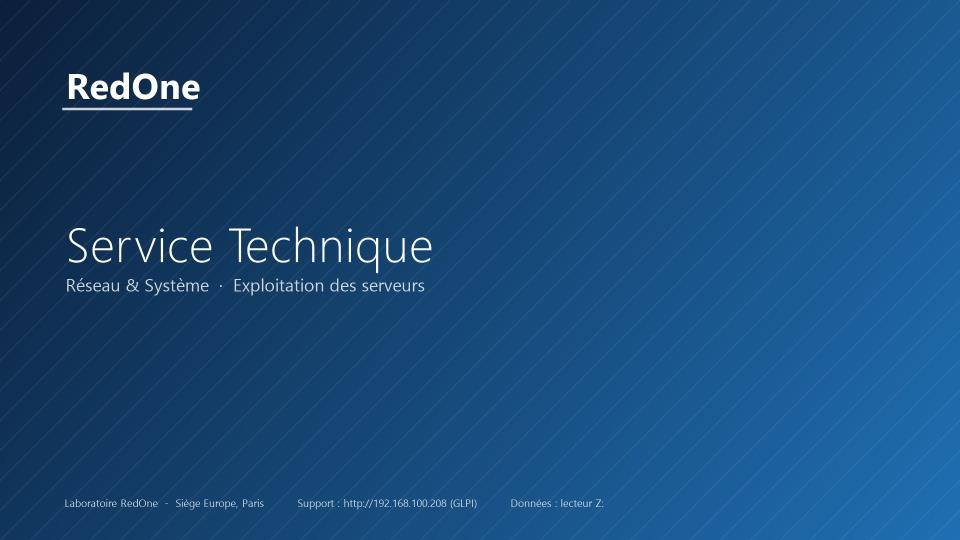 | 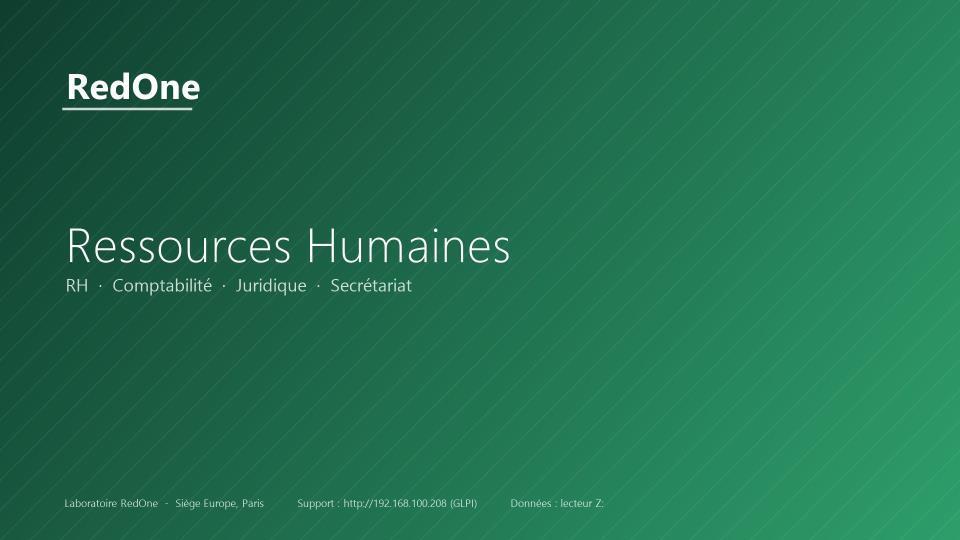 |
| **Commercial** | **Admin** |
|  | 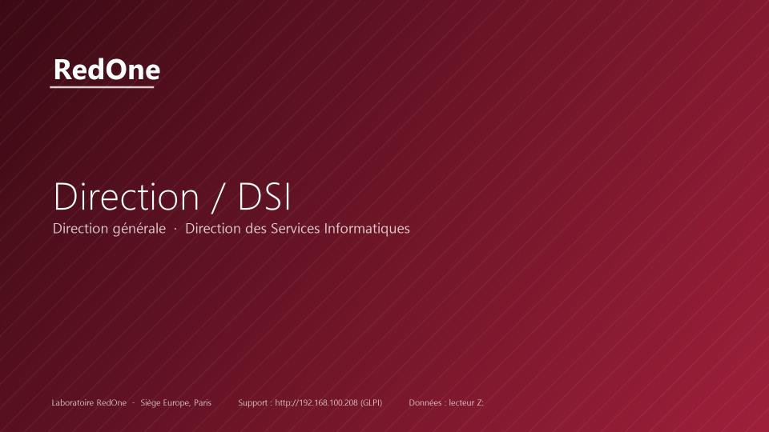 |

Test à réaliser sur un poste du domaine : ouvrir une session avec un compte de chaque rôle (ex. `aleroy` pour RH, `ivincent` pour Commercial) et vérifier le fond d'écran et le lecteur Z: ; `gpresult /r` liste les GPO appliquées.

Scripts : [`AP1/ad/`](ad/)

### 5.3 Autoriser le ping sur les serveurs Windows

Par défaut, le pare-feu Windows bloque l'ICMP entrant. Pour les tests de connectivité :

```powershell
Get-NetFirewallRule -DisplayName "Diagnostics de réseau de base - Demande d'écho ICMP (ICMPv4-Entrant)" | Enable-NetFirewallRule
```

### 5.4 GLPI – gestion de parc et du support

GLPI répond au besoin RedOne d'**uniformiser le suivi** : tickets d'incidents et de demandes, inventaire du parc (postes du siège et portables des visiteurs médicaux) et rattachement des équipements aux services.

#### Machine virtuelle

| Paramètre | Valeur |
|---|---|
| VM Proxmox | **208 – SRV-GLPI** (plage VMID 200–299), tags `ap1`, `glpi`, `redone` |
| Système | Debian 13 (image cloud, déploiement cloud-init) |
| Ressources | 2 vCPU, 4 Go RAM, 32 Go (stockage `Raid5-VMs`) |
| Réseau – administration | `eth0` sur `vmbr0` : `192.168.100.208/24`, passerelle `192.168.100.1` (accès web et SSH depuis le poste admin) |
| Réseau – serveurs | `eth1` sur `vmbr2`, VLAN 200 : `10.2.1.50/24` (accès à l'AD `10.2.1.10` en LDAP et aux serveurs) |
| Accès | `https://192.168.100.208` (ou `http://`) – SSH par clé uniquement (compte `sysadmin`, pas de mot de passe) |
| Pool Proxmox | `Faaaah` (visible avec le compte Proxmox de Fahim) |

> La VM a deux cartes : l'interface web est publiée sur le réseau d'administration de la salle, et la carte VLAN 200 lui donne accès aux serveurs RedOne (AD). Cible RedOne : VLAN Serveurs, `172.16.0.50` (tableau 3.2).

#### Pile logicielle

| Composant | Version |
|---|---|
| GLPI | 12.0.2 |
| Apache | 2.4 (racine web limitée à `/var/www/glpi/public`, `mod_rewrite`) |
| PHP | 8.4 (`mod_php`, extensions mysql, intl, ldap, gd, curl, zip, bz2, bcmath, opcache, apcu) |
| MariaDB | 11.8 (base `glpi` en `utf8mb4`, utilisateur dédié limité à cette base, fuseaux horaires chargés) |
| node_exporter | supervision par Prometheus (port 9100, voir AP2) |

#### Sécurisation appliquée

| Mesure | Détail |
|---|---|
| Racine web restreinte | Seul `public/` est exposé : config, données et journaux ne sont pas accessibles par HTTP (vérifié : HTTP 404) |
| Arborescence séparée | Configuration dans `/etc/glpi`, données dans `/var/lib/glpi`, journaux dans `/var/log/glpi` (propriétaire `www-data`, droits 750) ; code en lecture seule (propriétaire `root`) |
| Assistant d'installation supprimé | `install/install.php` supprimé après installation (vérifié : HTTP 404) |
| Comptes par défaut neutralisés | `glpi`, `tech`, `normal`, `post-only` : mot de passe aléatoire **et** compte désactivé |
| Comptes nominatifs | `admin.redone` (Super-Admin, groupe DSI), `tech.reseau` (Technicien, groupe Réseau & Système), `visiteur.demo` (Self-Service, groupe Visiteurs médicaux) – mots de passe forts générés, conservés hors dépôt |
| Base de données | Mot de passe aléatoire de 24 caractères, utilisateur limité à la base `glpi` |
| HTTPS | TLS 1.2 / 1.3 uniquement, certificat auto-signé `glpi.redone.local` (à remplacer par un certificat de l'AC interne RedOne), HSTS |
| En-têtes HTTP | `X-Content-Type-Options: nosniff`, `X-Frame-Options: SAMEORIGIN`, `Referrer-Policy` |
| Politique de mots de passe | 12 caractères minimum, majuscule + chiffre + symbole obligatoires, expiration 180 jours |
| Sessions | Pas de « se souvenir de moi », expiration après 1 h d'inactivité, cookies `HttpOnly` et `SameSite=Lax` |
| Apache / PHP | `ServerTokens Prod`, `ServerSignature Off`, `expose_php = Off` (versions non divulguées) |
| API REST | Désactivée (utilisée uniquement depuis `localhost` pour le peuplement initial, jeton effacé ensuite) |
| Tâches automatiques | Cron système toutes les minutes (`/etc/cron.d/glpi`) |
| Sauvegarde | Chaque nuit à 1 h 30 : base (`mysqldump`) + configuration + documents dans `/var/backups/glpi` (root uniquement, rétention 7 jours) – testée : 447 tables |

#### Référentiel RedOne chargé

| Élément | Contenu |
|---|---|
| Entité | **RedOne** (siège Europe, Paris) |
| Lieux | Paris - Siège › 6e étage - Salle serveur, Salles de réunion, Salle Démonstration, Accueil ; Terrain - Visiteurs médicaux |
| Groupes | DSI › Réseau & Système, Développement ; Direction ; RH / Compta / Juridique ; Communication / Rédaction ; Commercial ; Labo-Recherche ; Visiteurs médicaux (alignés sur les VLAN) |
| Catégories de tickets (16) | Matériel (poste, portable visiteur, imprimante, serveur) ; Réseau (accès / VLAN, Wi-Fi, VPN nomade) ; Logiciel (BDMED / BDPHARMA, messagerie, saisie des visites / frais) ; Comptes et accès (compte AD, mot de passe, droits) ; Sécurité (alerte antivirus, alerte supervision / SIEM, suspicion de fuite) |
| Inventaire | Inventaire natif activé (réception des agents GLPI) |

#### Attribution automatique des tickets

Mode d'attribution de l'entité : **catégorie puis matériel**. Chaque catégorie porte un groupe technique :

| Catégories | Groupe attribué | Technicien par défaut |
|---|---|---|
| Matériel, Réseau, Comptes et accès, Sécurité, Logiciel (messagerie, BDMED / BDPHARMA) | DSI › Réseau & Système | `tech.reseau` (Réseau et Sécurité) |
| Logiciel › Saisie des visites / frais | DSI › Développement | – |

#### Parc et tickets de démonstration

| Type | Éléments |
|---|---|
| Serveurs (9 ordinateurs au total) | SRV-AD (VM 105), SRV-AD2 (VM 206), SRV-SUPERVISION (VM 204), SRV-GLPI (VM 208), SRV-TRUENAS (VM 205) – lieu : salle serveur, technicien : groupe Réseau & Système |
| Postes | PC-ACCUEIL-01, PC-COMMERCIAL-01, PORTABLE-VIS-001 (attribué à `visiteur.demo`), PORTABLE-VIS-002 (en stock) |
| Réseau | FW-PFSENSE (VM 207), AP-WIFI-REUNION-01 (VLAN Visiteurs) |
| Impression | IMP-ACCUEIL-01 |
| Tickets | 4 tickets `[DEMO]` (frais de déplacement, alerte ClamAV, création de compte AD, Wi-Fi salle de réunion), tous **attribués automatiquement** au bon groupe |

#### Annuaire LDAP (Active Directory RedOne)

Annuaire **« AD RedOne »** actif (*Configuration → Authentification → Annuaires LDAP*) :

| Paramètre | Valeur |
|---|---|
| Serveur | `10.2.1.10:389` (VM 105, `RedOne.RedOne.local`) – joignable depuis `eth1` |
| Base DN | `DC=RedOne,DC=local` |
| Compte de connexion | `CN=svc-glpi,CN=Users,DC=RedOne,DC=local` – compte de service dédié, utilisateur standard (lecture seule), mot de passe fort aléatoire sans expiration, non modifiable par l'utilisateur ; stocké chiffré dans GLPI |
| Filtre | utilisateurs actifs uniquement (`objectCategory=person`, comptes désactivés exclus) |
| Identifiant / synchronisation | `samAccountName` / `objectGUID` |
| Champs | nom `sn`, prénom `givenName`, mail, téléphone, mobile, fonction ; groupes via `memberOf` |

| Résultat | **26 utilisateurs AD importés** dans GLPI (synchronisation `ldap:synchronize_users`) |
| Règle d'habilitation | « AD RedOne - profil Self-Service » : tout compte authentifié par l'AD reçoit le profil **Self-Service** dans l'entité RedOne → les employés se connectent à GLPI avec leur identifiant Windows |

Les techniciens et administrateurs gardent des comptes GLPI dédiés (`admin.redone`, `tech.reseau`) : un compte AD standard n'obtient jamais de droits d'administration GLPI automatiquement.

#### Accès d'administration aux serveurs

Toutes les interfaces sont publiées sur le réseau d'administration de la salle (`192.168.100.0/24`) : aucun poste particulier n'est nécessaire, un navigateur suffit.

| Serveur | Interface web (réseau admin) | Réseau RedOne (VLAN 200) |
|---|---|---|
| Proxmox | `https://192.168.100.2:8006` | – |
| SRV-GLPI (VM 208) | `http://192.168.100.208` | `10.2.1.50` |
| SRV-WAZUH (VM 209) | `https://192.168.100.209` | `10.2.1.51` |
| SRV-SUPERVISION (VM 204) – Grafana / Prometheus | `http://192.168.100.204:3000` / `:9090` | `10.2.1.3` |
| SRV-AD (VM 105) | console Proxmox | `10.2.1.10` |

| Accès | Mesure |
|---|---|
| SSH | Authentification **par clé uniquement** (mot de passe refusé), compte `sysadmin`, `root` interdit sur SRV-WAZUH |
| Console de secours | Mot de passe fort pour `sysadmin` sur SRV-GLPI et SRV-WAZUH, utilisable **uniquement via la console Proxmox** (conservé hors dépôt) |
| Passerelle d'administration | SRV-GLPI route vers le VLAN 200 **uniquement** pour le poste d'administration `192.168.100.141` (nftables : forward en *drop* par défaut, NAT en sortie) – service `redone-gw-admin` |

#### Suite prévue

- **Agent GLPI** sur les postes et serveurs (paquet officiel `glpi-agent`, serveur `https://192.168.100.208/`) pour remonter l'inventaire automatiquement.
- **Collecteur mail** et **notifications** : création de tickets et suivi par mail (serveur SMTP RedOne).
- **SLA** : délais de prise en charge et de résolution par priorité.

#### Captures d'écran

| | |
|---|---|
| **Page de connexion** (source « Base interne GLPI » ou « AD RedOne ») | **Tableau de bord** : données réelles RedOne (9 ordinateurs, 2 matériels réseau, 33 utilisateurs, 9 groupes, 4 tickets) |
|  | 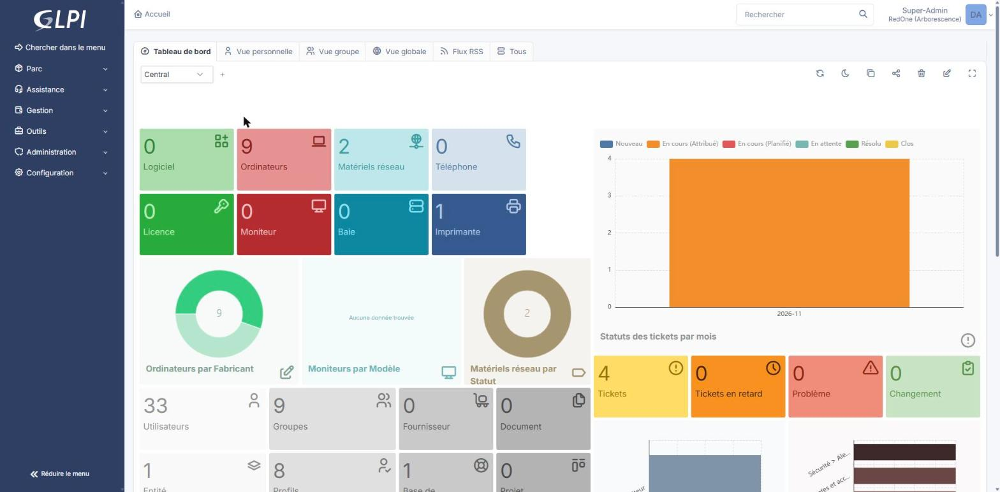 |
| **Tickets** : les 4 tickets de démonstration, tous « En cours (Attribué) » automatiquement | **Attribution automatique** : le ticket « frais de déplacement » est attribué au groupe DSI › Développement |
| 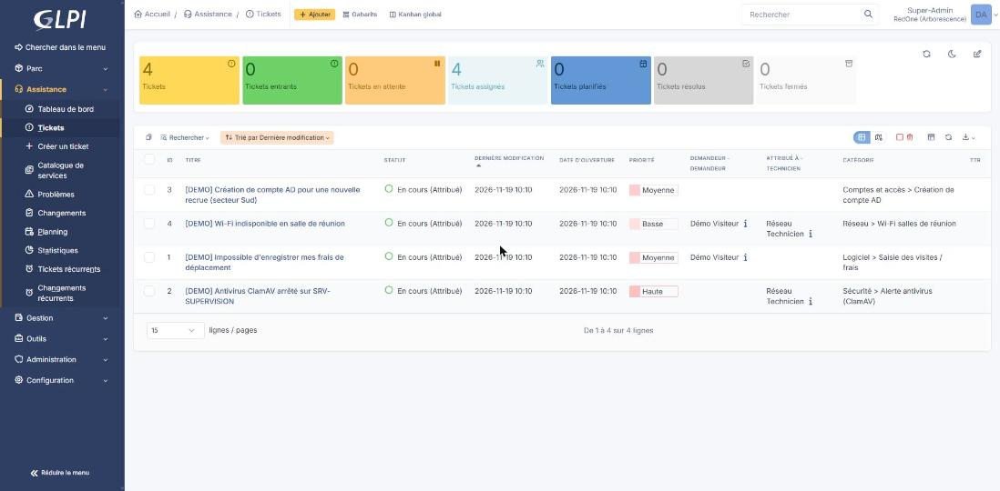 | 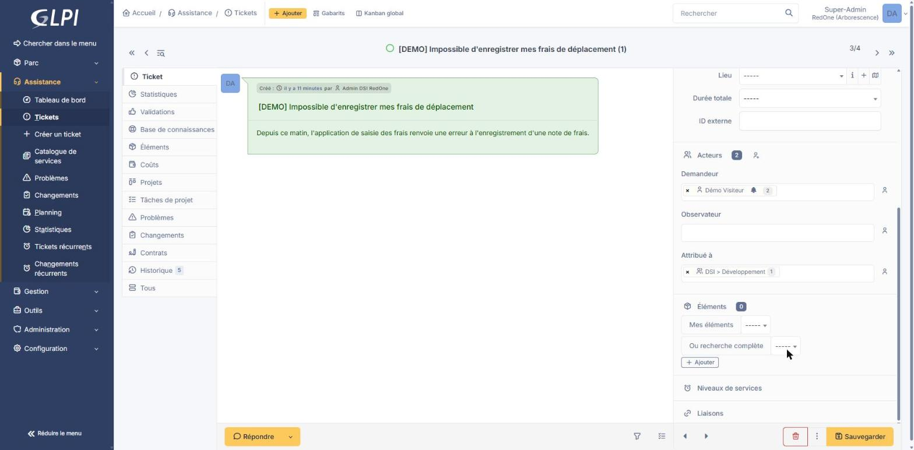 |
| **Parc** : serveurs virtuels (VM Proxmox), postes et portables des visiteurs | **Matériels réseau** : pare-feu pfSense et borne Wi-Fi |
| 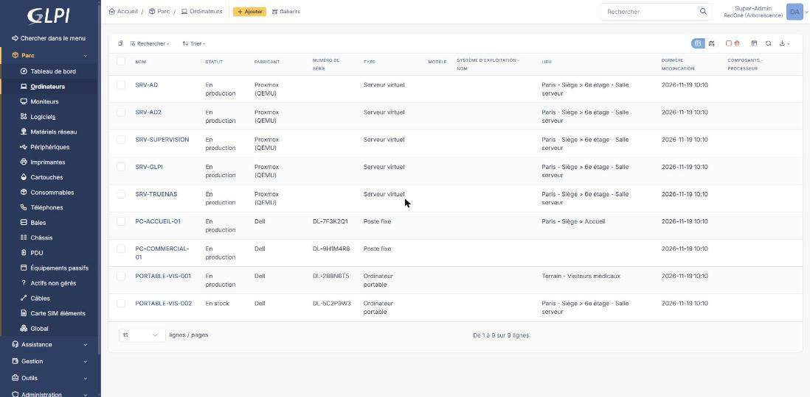 | 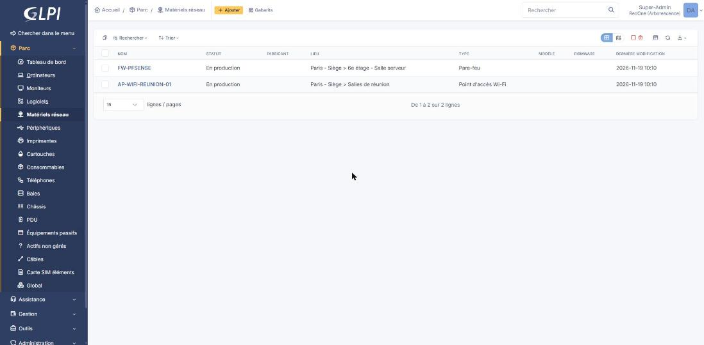 |
| **Catégories ITIL** du support RedOne | **Lieux** : siège de Paris et terrain |
| 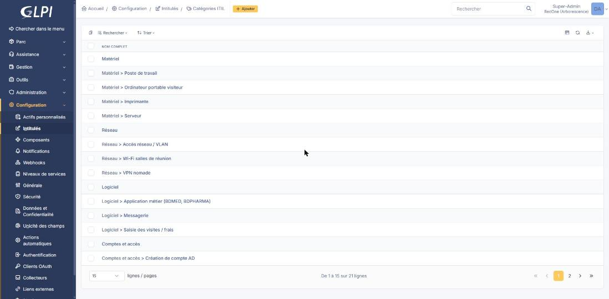 | 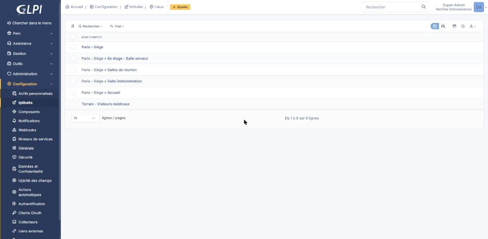 |
| **Sécurité** : GLPI redemande le mot de passe avant d'ouvrir une zone sensible (utilisateurs, groupes, annuaire LDAP) | |
| 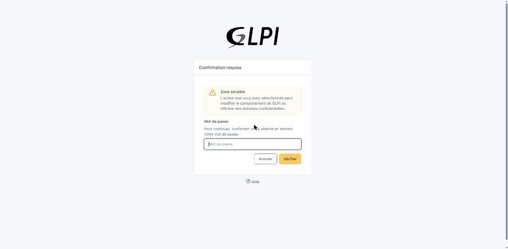 | |

## 6. Tests et validation

| # | Test | Commande / méthode | Résultat attendu | Résultat obtenu | ✅/❌ |
|---|---|---|---|---|---|
| 1 | Accès à l'interface Proxmox | navigateur → `https://192.168.100.2:8006` | Page de connexion | | |
| 2 | VLAN utilisateur → Serveurs | `ping 172.16.0.1` depuis une VM du VLAN 101 | Réponse | | |
| 3 | VLAN utilisateur → autre VLAN | `ping 192.168.30.254` depuis une VM du VLAN 106 | Pas de réponse (bloqué) | | |
| 4 | VLAN utilisateur → Internet | `ping 1.1.1.1` depuis une VM du VLAN 102 | Réponse | | |
| 5 | Visiteurs → DNS | `nslookup redone.local 172.16.0.1` depuis le VLAN 115 | Résolution OK | | |
| 6 | Visiteurs → autre serveur | `ping 172.16.0.50` (GLPI) depuis le VLAN 115 | Pas de réponse (bloqué) | | |
| 7 | Visiteurs → Internet | navigateur → site public | Page affichée | | |
| 8 | Ping d'un serveur Windows | `ping <IP serveur>` | Réponse après activation de la règle ICMP | | |
| 9 | Groupes AD présents | `Get-ADGroup -Filter 'Name -like "*S*"'` | `BTS SIO1`, `SLAM`, `SISR` | | |
| 10 | Accès GLPI | navigateur → `http://192.168.100.208` | Page de connexion GLPI | HTTP 200, page « Connexion à votre compte » | ✅ |
| 10b | Assistant d'installation inaccessible | `http://192.168.100.208/install/install.php` | 404 | 404 | ✅ |
| 10c | Comptes par défaut | connexion avec `glpi` | Refusée (compte désactivé) | | |
| 10d | HTTPS | `https://192.168.100.208` | Page de connexion, en-têtes HSTS et `nosniff` | HTTP 200, en-têtes présents | ✅ |
| 10e | GLPI → AD | test du port 389 depuis SRV-GLPI vers `10.2.1.10` | Port ouvert | Ouvert, annuaire `RedOne.local` lu | ✅ |
| 10e2 | Compte de service LDAP | `ldapwhoami` avec `svc-glpi` | Authentification réussie | `REDONE0\svc-glpi` | ✅ |
| 10e3 | Import des utilisateurs AD | synchronisation LDAP dans GLPI | Comptes importés avec un profil | 26 importés, 26 avec profil Self-Service | ✅ |
| 10f | Attribution automatique | création d'un ticket « Saisie des visites / frais » | Attribué au groupe Développement | Attribué à Développement | ✅ |
| 10g | Sauvegarde | exécution de `glpi-backup.sh` | Dump complet de la base | 447 tables sauvegardées | ✅ |
| 11 | IP statique pfSense | redémarrage pfSense puis vérification de l'IP | IP inchangée | | |

## 7. Gestion des secrets

Aucun identifiant n'est stocké dans ce dépôt. Les comptes d'administration (Proxmox, pfSense, Zabbix, AD) sont conservés dans le gestionnaire de mots de passe de l'équipe.

Bonnes pratiques appliquées :

- changement des mots de passe par défaut dès l'installation ;
- un compte nominatif par administrateur plutôt que le compte `root` partagé ;
- captures d'écran vérifiées avant commit.

## 8. Bilan

*À compléter : difficultés rencontrées, solutions, compétences mobilisées (bloc 1 / bloc 2 SISR).*
