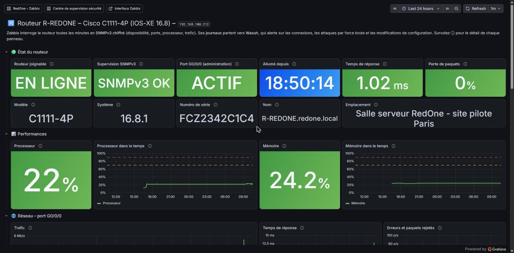
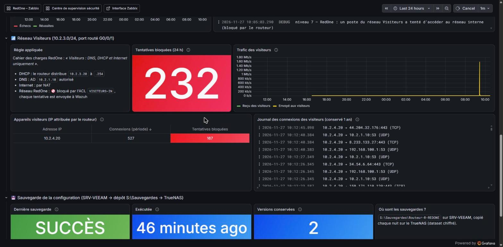
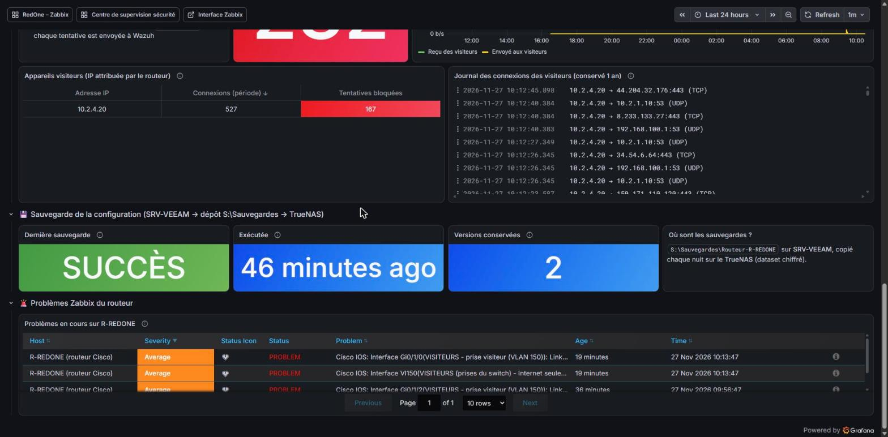
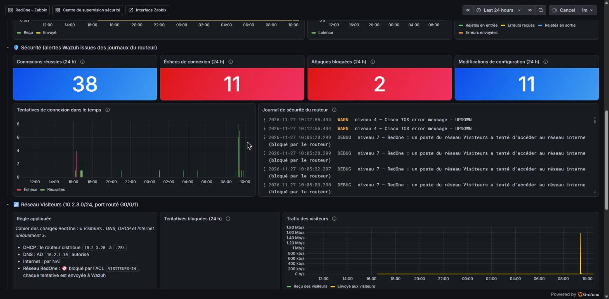

# AP2 – Le réseau est sécurisé… mais n'existe-t-il que le réseau interne ?

> **Problématique :** *L'AP1 a rendu le SI de RedOne maîtrisé **à l'intérieur**. Mais une entreprise ne vit pas en vase clos : elle sort sur Internet, elle reçoit des visiteurs qui veulent du Wi-Fi, et tout passe par un équipement de bordure, le routeur. Comment **ouvrir le réseau vers l'extérieur sans s'exposer**, et garder la trace de ce qui le traverse ?*

---

## 1. Le constat : la frontière était le point faible

Dans l'AP1, chaque serveur a été protégé. Mais le **routeur**, qui relie le réseau à l'extérieur, n'avait jamais été configuré. Or s'il est compromis, tout le reste l'est : un attaquant peut détourner le trafic, ouvrir l'accès aux serveurs ou couper le site.

Le cahier des charges de RedOne impose aussi une règle pour l'extérieur : *« le VLAN Visiteurs accède **uniquement** aux serveurs DNS et DHCP et à Internet »*. Et la loi ajoute une obligation : quiconque offre un accès Internet au public doit **conserver les données de connexion pendant un an** (Code des postes et communications électroniques, art. L34-1).

L'AP2 traite donc trois questions, sur un **routeur physique Cisco C1111-4P** (IOS-XE 16.8) :
1. **Bloquer** : empêcher qu'on prenne le contrôle de la porte d'entrée.
2. **Ouvrir sans exposer** : donner Internet aux visiteurs, sans leur donner le réseau RedOne.
3. **Tracer et réparer** : savoir ce qui a traversé la frontière, et pouvoir reconstruire le routeur.

```
                Internet
                    │
     ┌──────── pfSense ──────── VLAN 200 : serveurs et postes RedOne (10.2.1.0/24)
     │
  réseau de la salle 192.168.100.0/24
     │
  R-REDONE (Cisco)  ── G0/0/0 : administration 192.168.100.212
     ├── G0/0/1        ── Visiteurs 10.2.3.0/24  ┐  DHCP, NAT vers Internet,
     └── G0/1/0 à 0/1/3 ── Visiteurs VLAN 150    ┘  réseau RedOne interdit (ACL)
                          10.2.4.0/24
```

## 2. État des lieux du routeur : AVANT

Branchement par le **câble console** (USB, 9600 bauds) et relevé de la configuration d'origine ([`routeur/00-etat-des-lieux-avant.txt`](routeur/00-etat-des-lieux-avant.txt)) :

| Constat | Risque |
|---|---|
| **aucun mot de passe**, ni en console ni en mode privilégié | quiconque branche un câble prend le contrôle total |
| SSH désactivé, aucun compte | pas d'administration à distance sécurisée, aucune traçabilité |
| interface web HTTPS active | surface d'attaque inutile |
| aucun journal envoyé, aucune supervision, horloge fausse de 18 min | une attaque ou une panne passerait inaperçue |

## 3. Bloquer : sécuriser la porte d'entrée

Commandes appliquées ([`routeur/01-securisation.txt`](routeur/01-securisation.txt), commentées ligne par ligne) :

```
hostname R-REDONE
username admin-fahim privilege 15 algorithm-type scrypt secret ****     ! compte nominatif, mot de passe haché (scrypt)
security passwords min-length 12
crypto key generate rsa general-keys modulus 2048
ip ssh version 2                                                         ! SSH v2 uniquement, plus de Telnet
ip access-list standard ADMIN-SSH
 permit host 192.168.100.141                                             ! seul le poste d'administration
login block-for 120 attempts 3 within 60                                 ! 3 échecs en 1 min → blocage 2 min
line vty 0 4
 access-class ADMIN-SSH in
 transport input ssh
 login local
 exec-timeout 5 0                                                        ! déconnexion après 5 min
no ip http server
no ip http secure-server
no cdp run
banner login % ACCES RESERVE - RedOne. Toute connexion est journalisee. %
```

**Test : attaque par force brute.** 3 mauvais mots de passe en SSH : le routeur se bloque et Wazuh lève une alerte critique en moins d'une seconde.

```
16:37  Wazuh 4724  niv 9   Cisco IOS: Failed login to the router  [user: admin-fahim] [Source: 192.168.100.141]
16:37  Wazuh 4724  niv 9   Cisco IOS: Failed login to the router
16:37  Wazuh 4724  niv 9   Cisco IOS: Failed login to the router
16:37  Wazuh 100120 niv 12 RedOne : attaque par force brute sur le routeur R-REDONE, connexions bloquées
```

Depuis le poste d'administration, seul le port 22 (SSH) répond ; 23 (Telnet), 80 et 443 sont fermés.

## 4. Raccorder la frontière aux outils de l'AP1

| Lien | Configuration | Effet |
|---|---|---|
| **Wazuh** (journaux) | `logging host 192.168.100.209` | connexions, échecs, modifications de configuration (avec l'auteur) → alertes 4722, 4724, 100120 à 100125 |
| **Zabbix** (SNMPv3) | `snmp-server user zabbix ZABBIX v3 auth sha … priv aes 128 …`, lecture seule, ACL : seul SRV-ZABBIX | 47 mesures (ports, trafic, processeur, mémoire) et 20 alertes automatiques |
| **NTP** | `ntp server 10.2.1.10 prefer` | horloge juste (elle avançait de 18 min) : les alertes sont à la bonne heure |

SNMPv3 *authPriv* : authentification **et** chiffrement ; aucune communauté v1/v2c qui circulerait en clair.



## 5. Ouvrir sans exposer : le réseau Visiteurs

Le routeur offre **5 prises Visiteurs** : le port routé G0/0/1 (`10.2.3.0/24`) et les 4 prises de son switch intégré, dans le **VLAN 150**, le numéro du VLAN Visiteurs du cahier des charges (`10.2.4.0/24`). ([`routeur/07-visiteurs-g001.txt`](routeur/07-visiteurs-g001.txt), [`routeur/08-visiteurs-switch.txt`](routeur/08-visiteurs-switch.txt))

```
ip dhcp pool VISITEURS-SWITCH                     ! le routeur distribue les adresses
 network 10.2.4.0 255.255.255.0
 default-router 10.2.4.1
 dns-server 10.2.1.10
ip access-list extended VISITEURS-IN              ! la règle du cahier des charges
 permit udp any host 10.2.1.10 eq domain          !   DNS : autorisé
 deny ip any 10.0.0.0 0.255.255.255 log           !   réseau RedOne : interdit et journalisé
 deny ip any 172.16.0.0 0.15.255.255 log
 deny ip any 192.168.0.0 0.0.255.255 log
 permit ip any any                                !   Internet : autorisé
ip nat inside source list NAT-VISITEURS interface GigabitEthernet0/0/0 overload
```

| Test sur un PC branché sur une prise Visiteurs | Résultat |
|---|---|
| adresse reçue | ✅ `10.2.4.20` (DHCP du routeur) |
| `ping 8.8.8.8`, navigation | ✅ Internet fonctionne (NAT) |
| `nslookup google.fr` | ✅ DNS de l'AD autorisé |
| `ping 10.2.1.10` (AD), accès à GLPI | ❌ **bloqué**, journalisé, alerte Wazuh 100123 |

**Choix : réseau ouvert mais isolé.** Un réseau invité n'authentifie pas les appareils : sa sécurité vient de l'**isolement** et de la **traçabilité**. (La sécurité de port par adresse MAC a été envisagée, mais n'existe pas sur le switch intégré du C1111.)

## 6. Tracer : qui est passé par la frontière ?

- `ip nat log translations syslog` : chaque connexion d'un visiteur vers Internet est journalisée (IP du visiteur, destination, heure).
- Ces journaux partent vers SRV-SUPERVISION (rsyslog → Loki) et sont **conservés 1 an**, comme l'exige l'article L34-1 ; le reste des journaux reste à 30 jours (RGPD).
- Grafana affiche les **appareils visiteurs** (IP, nombre de connexions, tentatives bloquées) et le **journal de leurs connexions**.



Les tentatives bloquées (167 pour le PC de test) sont surtout le PC Windows qui cherche automatiquement le réseau local : la preuve que l'isolement fonctionne.

## 7. Réparer : la configuration du routeur est sauvegardée

Un routeur détruit ou mal configuré doit pouvoir être reconstruit rapidement.

| Élément | Choix |
|---|---|
| Principe | **SRV-VEEAM vient chercher** la configuration (`show running-config`) en SSH, toutes les 4 h et à 3 h 30 |
| Authentification | compte `svc-sauvegarde` du routeur **par clé SSH** : aucun mot de passe stocké nulle part |
| Stockage | `S:\Sauvegardes\Routeur-R-REDONE\R-REDONE_<date>.cfg`, **nouvelle version seulement si la configuration a changé**, 90 jours ; copié chaque nuit sur le TrueNAS avec les sauvegardes Veeam |
| Supervision | résultat envoyé à Zabbix ; alerte si échec ou plus de 26 h sans sauvegarde |
| Restauration | `copy scp: bootflash:` puis `configure replace bootflash:R-REDONE_<date>.cfg` |

Constaté : 4 exécutions dans la nuit → « configuration inchangée » ; le matin, après l'ajout du réseau Visiteurs → nouvelle version créée automatiquement.



## 8. Superviser la frontière

Le dashboard Grafana **« RedOne – Routeur R-REDONE »** rassemble l'état, les performances, le trafic, la sécurité (connexions, échecs, attaques bloquées, modifications), le réseau Visiteurs et la sauvegarde.



## 9. Bilan

| Question de départ | Réponse apportée |
|---|---|
| Le routeur était-il protégé ? | Non → compte nominatif, SSH v2 seul, ACL, blocage après 3 échecs, services inutiles coupés |
| Voit-on ce qui se passe à la frontière ? | Oui → Wazuh (alertes), Zabbix (SNMPv3), Grafana (tableau de bord dédié), heure synchronisée |
| Peut-on accueillir des visiteurs sans risque ? | Oui → réseau Visiteurs isolé : DNS et Internet seulement, tout le reste bloqué et journalisé |
| Respecte-t-on la loi ? | Oui → journal des connexions conservé 1 an (L34-1), bannière légale, durées limitées ailleurs (RGPD) |
| Peut-on reconstruire le routeur ? | Oui → configuration sauvegardée automatiquement, versionnée, copiée hors du serveur |

**Pour aller plus loin :**
- **VPN pour les 540 visiteurs médicaux nomades**, pour qu'ils accèdent au siège de façon chiffrée ;
- **portail captif** d'acceptation de charte pour le Wi-Fi Visiteurs, et **802.1X** sur un vrai switch d'accès ;
- **mise à jour d'IOS-XE** : la 16.8 n'accepte que des algorithmes SSH anciens (SHA-1) ;
- authentification des administrateurs du routeur sur l'AD (**RADIUS**), et restauration de configuration chronométrée dans le PRA.

---

**Fichiers :** [`routeur/`](routeur/README.md) (commandes IOS dans l'ordre, configuration finale), [`scripts/`](scripts/) (supervision Zabbix et Grafana du routeur, sauvegarde de la configuration).
