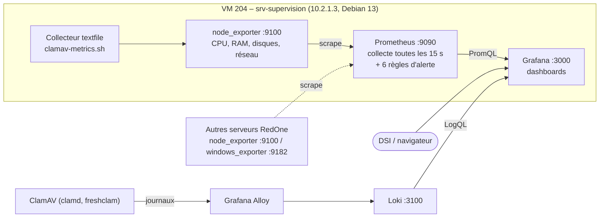
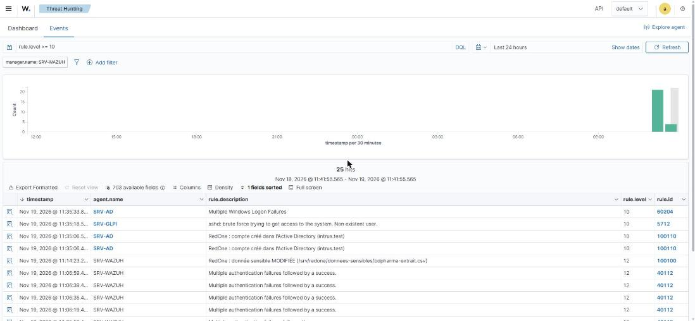
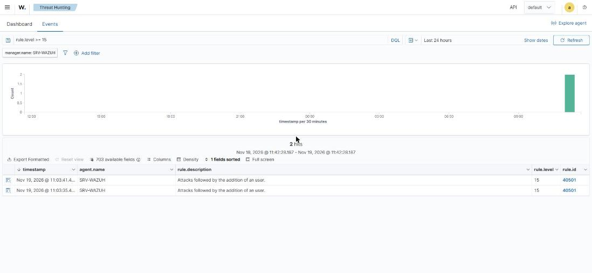
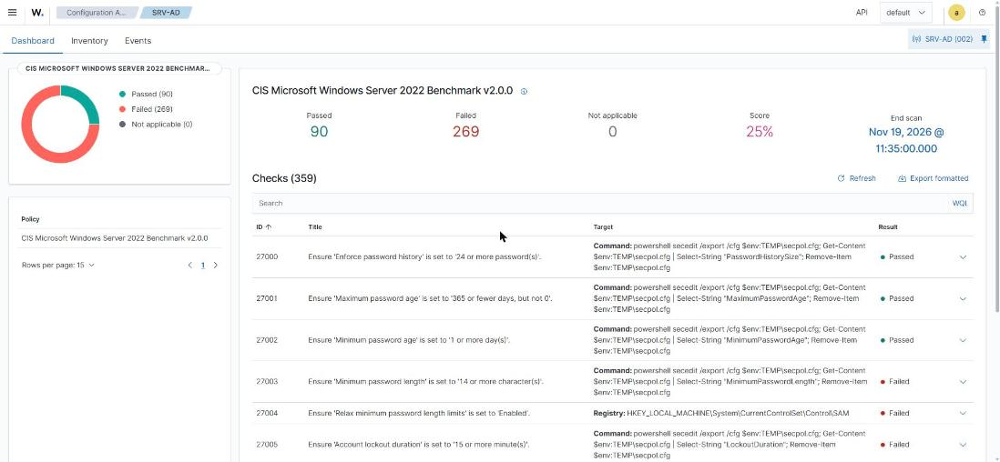
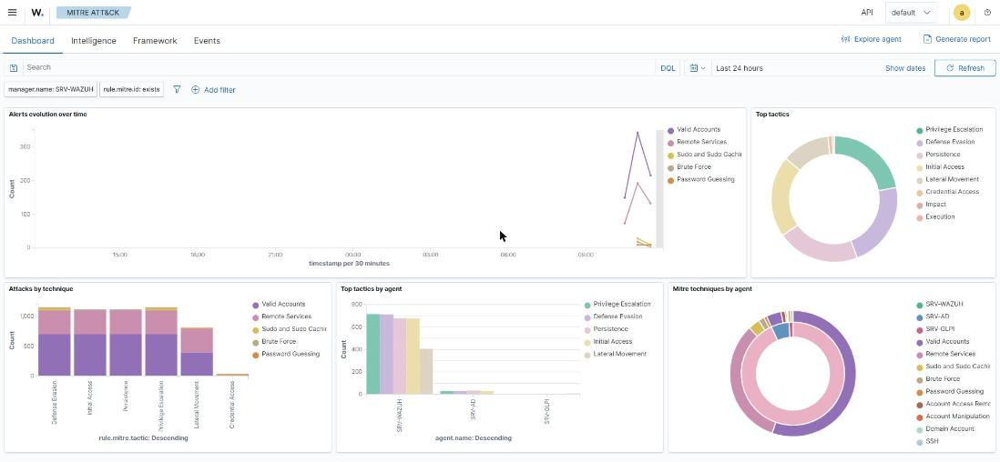

# AP2 – Exploitation et sécurité du système d'information

> **Auteur :** à compléter · **Prérequis :** [AP1](../AP1/AP1_Systeme_Information.md)

## Sommaire

1. [Objectifs](#1-objectifs)
2. [Services déployés](#2-services-déployés)
3. [Supervision – Prometheus / Grafana](#3-supervision--prometheus--grafana)
4. [Sécurité – Wazuh](#4-sécurité--wazuh)
5. [Sauvegarde et PRA](#5-sauvegarde-et-pra)
6. [RGPD](#6-rgpd)
7. [Scénario de démonstration](#7-scénario-de-démonstration)
8. [Bilan](#8-bilan)

---

## 1. Objectifs

- Superviser les serveurs et équipements réseau, avec alertes.
- Détecter les événements de sécurité (SIEM / XDR Wazuh).
- Garantir la reprise d'activité (sauvegardes Proxmox, PRA).
- Documenter la conformité RGPD des traitements.

## 2. Services déployés

| Service | IP | Rôle | État |
|---|---|---|---|
| **Prometheus + Grafana + ClamAV** (VM 204, Debian 13) | `192.168.100.204` (admin) / `10.2.1.3` (VLAN 200) | Collecte de métriques, alertes, tableaux de bord, antivirus | ✅ Opérationnel |
| Zabbix | `10.1.0.5` *(ou `192.168.100.133`, à confirmer)* | Supervision par agents / SNMP | ⏳ En cours |
| **Wazuh 4.14** (VM 209 SRV-WAZUH) | `192.168.100.209` / `10.2.1.51` | SIEM / XDR : détection d'intrusion, intégrité des fichiers, conformité CIS | ✅ Opérationnel |
| pfSense | `10.1.0.15` | Pare-feu, journaux réseau | ✅ VLAN en place |
| GLPI 12 (VM 208 SRV-GLPI) | `192.168.100.208` | Gestion des incidents et du parc | ✅ Opérationnel |

## 3. Supervision – Prometheus / Grafana

Réponse à l'axe « Supervision et exploitation » du [cahier des charges RedOne](../CONTEXTE_RedOne.md#5-axes-dévolution-proposés) : suivre la disponibilité et les performances des serveurs, avec alertes et tableaux de bord pour la DSI.

### 3.1 Architecture



| Composant | Version | Port | Rôle |
|---|---|---|---|
| Prometheus | 2.53.3 | 9090 | Base de séries temporelles, collecte (*scrape*) et évaluation des alertes |
| node_exporter | 1.9.0 | 9100 | Expose les métriques système + les métriques ClamAV (collecteur *textfile*) |
| Grafana | 13.3.1 | 3000 | Visualisation, source de données Prometheus provisionnée |
| ClamAV | – | – | Antivirus temps réel (`clamonacc`), scan hebdomadaire de `/home` (dimanche 2 h), quarantaine dans `/var/quarantine`, base mise à jour par `freshclam` |
| Grafana Alloy + Loki | – | 3100 | Collecte des journaux ClamAV (`clamd`, `freshclam`) et stockage pour les panneaux « Détections » et « Menaces » |

### 3.2 Configuration de Prometheus

Fichiers versionnés dans [`AP2/supervision/`](supervision/) :

| Fichier sur la VM | Fichier du dépôt | Contenu |
|---|---|---|
| `/etc/prometheus/prometheus.yml` | [`prometheus.yml`](supervision/prometheus.yml) | Jobs `prometheus`, `node`, `linux`, `windows` |
| `/etc/prometheus/rules/redone-alerts.yml` | [`redone-alerts.yml`](supervision/redone-alerts.yml) | 6 règles d'alerte |
| `/etc/prometheus/targets/linux.yml` | – | Cibles Linux à ajouter (*file_sd*) |
| `/etc/prometheus/targets/windows.yml` | – | Cibles Windows à ajouter (*file_sd*) |

**Ajouter un serveur à superviser** sans redémarrer Prometheus :

```yaml
# /etc/prometheus/targets/linux.yml
- targets: ['172.16.0.50:9100']
  labels:
    host: 'srv-glpi'
```

Sur le serveur à superviser (Debian) : `apt install prometheus-node-exporter`. Pour l'AD Windows : installer [windows_exporter](https://github.com/prometheus-community/windows_exporter) et ajouter la cible `IP:9182` dans `windows.yml`.

Validation de la configuration avant chaque redémarrage :

```bash
promtool check config /etc/prometheus/prometheus.yml
systemctl restart prometheus
```

### 3.3 Hôtes supervisés

| Hôte | IP | Méthode | État |
|---|---|---|---|
| srv-supervision (VM 204) | `10.2.1.3` | node_exporter + textfile ClamAV | ✅ UP |
| Prometheus | `10.2.1.3:9090` | auto-supervision | ✅ UP |
| SRV-GLPI (VM 208) | `10.2.1.50:9100` | node_exporter (job `linux`, label `host=srv-glpi`) | ✅ UP |
| SRV-WAZUH (VM 209) | `10.2.1.51:9100` | node_exporter (job `linux`, label `host=srv-wazuh`) | ✅ UP |
| AD | `192.168.100.2` → `172.16.0.1` | windows_exporter | ⏳ À ajouter |
| pfSense | `10.1.0.15` | paquet *node_exporter* pfSense ou SNMP (Zabbix) | ⏳ À ajouter |

### 3.4 Règles d'alerte Prometheus

| Alerte | Expression (résumé) | Durée | Sévérité |
|---|---|---|---|
| `HoteInjoignable` | `up == 0` | 3 min | critical |
| `CPUEleve` | CPU > 90 % | 5 min | warning |
| `MemoireFaible` | RAM disponible < 10 % | 5 min | warning |
| `EspaceDisqueFaible` | espace libre < 10 % | 5 min | critical |
| `ClamAVArrete` | `clamav_up == 0` | 5 min | critical |
| `SignaturesClamAVObsoletes` | base de signatures > 48 h | 1 h | warning |

Les alertes sont visibles dans Prometheus (*Alerts*) et dans le dashboard Grafana. Évolution prévue : Alertmanager pour l'envoi par mail / Telegram.

### 3.5 Dashboards Grafana

| Dashboard | Source | Contenu |
|---|---|---|
| **RedOne – Vue d'ensemble supervision** | créé pour l'AP ([`redone-overview.json`](supervision/redone-overview.json)) | Cibles UP / DOWN, alertes actives, uptime, état ClamAV, âge des signatures, CPU, RAM, disques, réseau, tableau des cibles et des alertes |
| RedOne – Serveurs Linux (Node Exporter) | dashboard communautaire *Node Exporter Full* (ID 1860) | Détail complet par serveur |
| ClamAV | existant | Métriques de l'antivirus |

Les dashboards sont **provisionnés** depuis `/var/lib/grafana/dashboards/` : ils sont recréés automatiquement au démarrage de Grafana et ne dépendent pas d'une manipulation dans l'interface.

Le dashboard **RedOne – Vue d'ensemble supervision** est défini comme page d'accueil de Grafana (`default_home_dashboard_path` dans `/etc/grafana/grafana.ini`).

Accès : **`http://192.168.100.204:3000`** depuis n'importe quel poste de la salle (2e carte réseau de la VM 204 sur le réseau d'administration), ou `http://10.2.1.3:3000` depuis le VLAN 200.

> **Incident du 19/11/2026** : la VM 204 (bureau GNOME) s'était mise en **veille automatique** ; Proxmox la voyait « running » mais elle ne répondait plus (Grafana, Prometheus, réseau). Correctif : redémarrage puis **désactivation définitive de la veille** (`systemctl mask sleep.target suspend.target hibernate.target …`, `logind` et `dconf` GNOME). Un serveur ne doit jamais se mettre en veille.

Captures : `captures/grafana_redone_overview.png`, `captures/prometheus_targets.png`, `captures/prometheus_alerts.png`

### 3.6 Tests de la supervision

| # | Test | Méthode | Résultat attendu | Résultat obtenu |
|---|---|---|---|---|
| 1 | Services actifs | `systemctl is-active prometheus prometheus-node-exporter grafana-server` | `active` ×3 | ✅ active ×3 (13/11/2026) |
| 2 | Configuration valide | `promtool check config` | `SUCCESS`, 6 règles | ✅ SUCCESS, 6 règles |
| 3 | Cibles collectées | Prometheus → *Status → Targets* | `node` et `prometheus` UP | ✅ 2/2 UP |
| 4 | Métriques ClamAV | requête `clamav_up` | `1` | ✅ 1 (3 642 972 signatures) |
| 5 | Grafana joignable depuis le réseau | `http://192.168.100.204:3000` depuis un poste de la salle | page de connexion | ✅ HTTP 200 |
| 5b | Supervision des autres serveurs | ajout de SRV-GLPI et SRV-WAZUH dans `targets/linux.yml` | 4 cibles UP | ✅ 4/4 UP (19/11/2026) |
| 5c | Chaîne antivirus de bout en bout | fichier de test **EICAR** (inoffensif) analysé par `clamdscan` puis supprimé | détection visible dans Grafana | ✅ « Eicar-Test-Signature FOUND » → journal clamd → Alloy → Loki → panneau « Détections (24 h) » = 1 |
| 5d | Panneaux des dashboards | contrôle de chaque requête des 3 dashboards | données présentes | ✅ Vue d'ensemble 12/12 (hors liste d'alertes vide), ClamAV 8/8, Node Exporter ≈ 257/301 par serveur (le reste : capteurs matériels absents sur VM) |
| 6 | Alerte hôte injoignable | `systemctl stop prometheus-node-exporter` puis attendre 3 min | `HoteInjoignable` *firing* | à faire en démo |
| 7 | Alerte ClamAV | `systemctl stop clamav-daemon` puis attendre 5 min | `ClamAVArrete` *firing* | à faire en démo |
| 8 | Retour à la normale | redémarrer les services | alertes résolues | à faire en démo |

### 3.7 Sauvegarde de la configuration

Avant modification, la configuration d'origine a été sauvegardée dans `/root/backup-supervision-20261113-145517/` sur la VM. Restauration : recopier `prometheus/` vers `/etc/prometheus/` puis `systemctl restart prometheus`.

### 3.8 Supervision Zabbix

#### Hôtes supervisés

| Hôte | IP | Agent / méthode | Template |
|---|---|---|---|
| Proxmox | `192.168.100.2` | Agent Zabbix | Linux by Zabbix agent |
| pfSense | `10.1.0.15` | SNMP | pfSense by SNMP |
| AD | à compléter | Agent Zabbix | Windows by Zabbix agent |
| GLPI | `192.168.100.50` | Agent Zabbix | Linux by Zabbix agent + HTTP |

#### Alertes configurées

| Déclencheur | Seuil | Sévérité | Notification |
|---|---|---|---|
| Hôte injoignable | 3 min sans réponse | Haute | à compléter (mail / Telegram) |
| CPU élevé | > 90 % pendant 5 min | Moyenne | |
| Espace disque faible | < 10 % libre | Haute | |
| Service web GLPI KO | code HTTP ≠ 200 | Haute | |

Capture : `captures/zabbix_dashboard.png`

## 4. Sécurité – Wazuh

Réponse à l'axe « Cybersécurité » du [cahier des charges RedOne](../CONTEXTE_RedOne.md#5-axes-dévolution-proposés) : détecter les incidents (SIEM) sur des données jugées stratégiques, qui « ne peuvent tolérer ni fuite, ni destruction ».

### 4.1 Serveur Wazuh

| Paramètre | Valeur |
|---|---|
| VM Proxmox | **209 – SRV-WAZUH** (pool `Faaaah`), tags `ap2`, `wazuh`, `redone` |
| Système | Debian 13, 4 vCPU, 8 Go RAM, 60 Go (`Raid5-VMs`) |
| Réseau | `eth0` `192.168.100.209/24` (administration, dashboard) – `eth1` VLAN 200 `10.2.1.51/24` (réception des agents RedOne) |
| Version | Wazuh **4.14.10**, installation tout-en-un (assistant officiel `wazuh-install.sh -a`) |
| Composants | Wazuh indexer (stockage des alertes), Wazuh manager (analyse, règles), Filebeat, Wazuh dashboard |
| Accès | `https://192.168.100.209` (compte `admin`, mot de passe conservé hors dépôt) |

| Port | Service |
|---|---|
| 443/TCP | Dashboard (HTTPS) |
| 1514/TCP | Communication agents → manager (chiffrée) |
| 1515/TCP | Enrôlement des agents (protégé par mot de passe) |
| 55000/TCP | API du manager |
| 9200/TCP | Indexer – écoute **uniquement en local** (127.0.0.1) |

### 4.2 Sécurisation et configuration

| Mesure | Détail |
|---|---|
| Enrôlement protégé | `use_password = yes` : un agent ne peut s'inscrire qu'avec le mot de passe d'enrôlement (`/var/ossec/etc/authd.pass`, droits 640) |
| Identifiants d'installation | Archive `wazuh-install-files.tar` déplacée de `/tmp` vers `/root` (droits 600) |
| FIM temps réel | `/etc/ssh`, `/etc/sudoers.d`, `/etc/passwd`, `/etc/group` et la zone de données `/srv/redone` surveillés **en temps réel**, avec historique des modifications (`report_changes`) |
| Réponse active | Blocage automatique (`firewall-drop`, 10 min) de l'IP source après brute force SSH (règle 5763) ; poste d'administration `192.168.100.141` en liste blanche |
| Journaux | Lecture de `journald` (Debian 13 n'a plus de `/var/log/auth.log`) |
| Conformité (SCA) | Audit automatique **CIS Debian Linux 13 Benchmark** |
| Vulnérabilités | Détection des vulnérabilités des paquets installés (activée par défaut) |

#### Règles personnalisées RedOne (`/var/ossec/etc/rules/local_rules.xml`)

| ID | Niveau | Déclenchement | MITRE ATT&CK |
|---|---|---|---|
| 100100 | **12** | Donnée sensible **modifiée** dans `/srv/redone` | T1565.001 (manipulation de données) |
| 100101 | **12** | Donnée sensible **supprimée** dans `/srv/redone` | T1485 (destruction de données) |
| 100102 | 10 | Nouveau fichier dans la zone de données sensibles | – |
| 100110 | 10 | Compte créé dans l'Active Directory RedOne (événement 4720) | T1136.002 |

Testé : la modification de `bdpharma-extrait.csv` lève désormais « **RedOne : donnée sensible MODIFIÉE** » en niveau 12 (au lieu de 7).

#### Groupes d'agents (configuration centralisée)

| Groupe | Cible | Configuration poussée aux agents |
|---|---|---|
| `linux-serveurs` | SRV-GLPI, SRV-SUPERVISION… | FIM temps réel (`/etc/ssh`, `/etc/shadow`, `/etc/glpi`, `/etc/apache2`, `/srv/redone`), journald, logs Apache de GLPI |
| `windows-ad` | SRV-AD, SRV-AD2 | Journaux Security, Directory Service et Windows Defender, FIM des GPO (`SYSVOL\Policies`), clés de registre Services et Run |

#### Durcissement du serveur (CIS Debian 13)

SSH (root interdit, clé uniquement, `MaxAuthTries 4`, bannière légale, `AllowUsers`), paramètres réseau du noyau (redirections, source routing, rp_filter, syncookies), ASLR, pas de core dumps, **auditd** (comptes, sudo, SSH, commandes root), durée de vie des mots de passe, droits cron.

**Score CIS : 44 % → 53 %** (99 contrôles réussis, 89 échoués, 19 non applicables), accès SSH par clé vérifié après durcissement.

### 4.3 Agents

| Machine | OS | IP | Agent |
|---|---|---|---|
| SRV-WAZUH (manager, agent 000) | Debian 13 | `10.2.1.51` | ✅ Actif (surveillance locale) |
| SRV-GLPI (VM 208) | Debian 13 | `10.2.1.50` | ✅ **Actif** – agent 001, groupe `linux-serveurs` – score CIS 43 % |
| SRV-AD (VM 105) | Windows Server 2022 | `10.2.1.10` | ✅ **Actif** – agent 002, groupe `windows-ad` – score CIS Windows Server 2022 : 25 % |

Les agents s'inscrivent sur `10.2.1.51` avec le mot de passe d'enrôlement (`WAZUH_REGISTRATION_PASSWORD`) et reçoivent automatiquement la configuration de leur groupe. Sur SRV-AD, l'audit des **échecs** d'ouverture de session, de validation des identifiants et de gestion des comptes a été activé (`auditpol`, non tracé par défaut sur un contrôleur de domaine).

### 4.4 Cas d'usage testés (19/11/2026)

| # | Scénario | Action de test | Alerte attendue | Obtenu | ✅/❌ |
|---|---|---|---|---|---|
| 1 | Brute force SSH | 10 connexions SSH avec l'utilisateur inexistant `attaquant` depuis `192.168.100.141` | 5710 puis 5712 | **9 × 5710** (niv. 5) puis **5712** « brute force » (niv. 10), IP source identifiée | ✅ |
| 2 | Fuite / altération de données (FIM) | modification de `/srv/redone/donnees-sensibles/bdpharma-extrait.csv` | 550 | **550** « Integrity checksum changed », contenu modifié visible | ✅ |
| 3 | Modification de configuration sensible | ajout d'une ligne dans `/etc/ssh/sshd_config` | 550 | **550** sur `sshd_config` | ✅ |
| 4 | Création de compte local | `useradd intrus.test` | 5902 | **5902** « New user added » + 5901 (groupe) + 550 sur `/etc/passwd` et `/etc/group` | ✅ |
| 5 | Corrélation d'attaque | brute force suivi d'une création de compte | 40501 | **40501** « Attacks followed by the addition of an user » (**niveau 15**, maximum) | ✅ |
| 6 | Élévation de privilèges | usage de `sudo` | 5402 / 5403 | **5403** « First time user executed sudo », 5402 | ✅ |
| 7 | Conformité CIS | audit SCA automatique | Score CIS | **44 %** à l'installation, **53 %** après durcissement | ✅ |
| 8 | Attaque par mots de passe sur l'AD | 8 connexions SMB avec le compte inexistant `attaquant` sur SRV-AD | 60122 puis 60204 | **7 × 60122** « Logon Failure » (événements 4625) puis **60204** « Multiple Windows Logon Failures » (**niv. 10**) | ✅ |
| 9 | Création / suppression de compte AD | `New-ADUser intrus.test` puis `Remove-ADUser` | 100110 / 60111 | **100110** « RedOne : compte créé dans l'Active Directory (intrus.test) » (**niv. 10**, règle RedOne) puis **60111** « User account deleted » | ✅ |
| 10 | Brute force SSH sur un serveur applicatif | 10 connexions SSH `attaquant` sur SRV-GLPI | 5710 / 5712 via l'agent | **9 × 5710** puis **5712** (niv. 10), remontés par l'agent SRV-GLPI | ✅ |
| 11 | Modification de la politique d'audit | `auditpol` sur SRV-AD | 60112 | **60112** « Windows Audit Policy changed » (niv. 8) | ✅ |

### 4.5 Captures d'écran du dashboard Wazuh

| | |
|---|---|
| **Vue d'ensemble** : 2 agents actifs, alertes des dernières 24 h (2 critiques, 18 hautes) | **Agents** : SRV-GLPI (Debian 13, groupe `linux-serveurs`) et SRV-AD (Windows Server 2022, groupe `windows-ad`), version 4.14.10 |
|  |  |
| **Alertes de niveau ≥ 10** : échecs de connexion Windows multiples, brute force SSH sur GLPI, création de compte AD et donnée sensible modifiée (règles RedOne) | **Alertes critiques (niveau 15)** : « Attacks followed by the addition of an user » |
|  |  |
| **Intégrité des fichiers** : modification de `bdpharma-extrait.csv` (règle 100100, niveau 12) et de la configuration SSH | **Conformité CIS** de SRV-AD : 90 contrôles réussis, 269 échoués, score 25 % |
|  |  |
| **MITRE ATT&CK** : tactiques et techniques détectées (Valid Accounts, Brute Force, Password Guessing…) | |
|  | |

### 4.6 Pistes d'amélioration

- Remonter le score CIS (44 %) : durcissement SSH, `auditd`, partitions séparées, AIDE.
- Agents sur tous les serveurs et postes RedOne, groupes d'agents par VLAN.
- Notifications des alertes de niveau ≥ 10 par mail, et création automatique d'un ticket GLPI.
- Remplacer le certificat auto-signé du dashboard par un certificat de l'AC interne RedOne.

## 5. Sauvegarde et PRA

| Élément | Méthode | Fréquence | Rétention | Testée |
|---|---|---|---|---|
| VM critiques (AD, GLPI, pfSense) | Sauvegarde Proxmox (vzdump, mode snapshot) | Quotidienne | 7 jours | ☐ |
| Configuration pfSense | Export XML (*Diagnostics → Backup & Restore*) | À chaque modification | Hors dépôt Git | ☐ |
| Base GLPI | `mysqldump` | Quotidienne | 7 jours | ☐ |

**Procédure de restauration testée :** *à compléter (restauration d'une VM depuis une sauvegarde, durée mesurée, RTO / RPO obtenus).*

## 6. RGPD

| Traitement | Données | Finalité | Durée de conservation | Accès |
|---|---|---|---|---|
| Comptes AD | nom, prénom, identifiant | Authentification | Durée de la scolarité | Administrateurs |
| GLPI | nom, matériel attribué | Gestion de parc | Durée de vie du matériel | Techniciens |
| Journaux Wazuh / Zabbix | IP, identifiants de connexion | Sécurité | 6 mois – 1 an (recommandation CNIL) | Administrateurs |

Mesures : comptes nominatifs, accès restreints par groupe AD, données de test fictives.

## 7. Scénario de démonstration

1. Présenter l'architecture (schéma réseau, VLAN).
2. Ouvrir le dashboard Grafana **RedOne – Vue d'ensemble supervision** : tout est vert.
3. Arrêter l'antivirus (`systemctl stop clamav-daemon`) → la tuile ClamAV passe à **ARRÊTÉ** → l'alerte `ClamAVArrete` se déclenche après 5 min → ouverture d'un ticket GLPI.
4. Arrêter `prometheus-node-exporter` → alerte `HoteInjoignable` → redémarrage → retour au vert.
5. Simuler un brute force SSH → alerte dans Wazuh.
6. Restaurer une VM depuis une sauvegarde Proxmox.

## 8. Bilan

*À compléter : résultats des tests, difficultés, améliorations possibles.*
