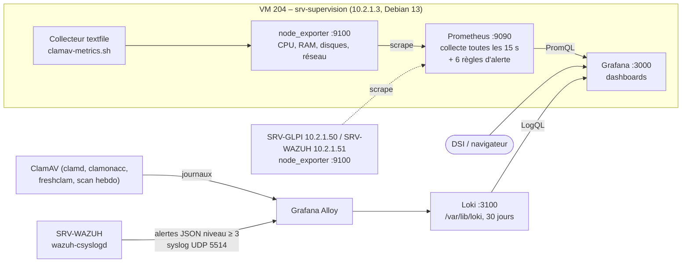
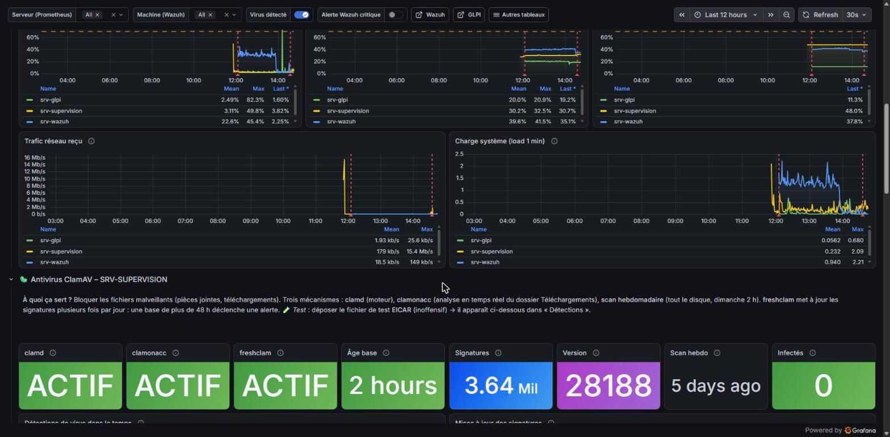
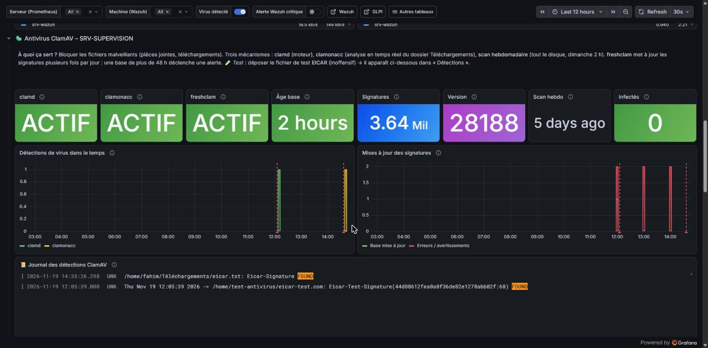
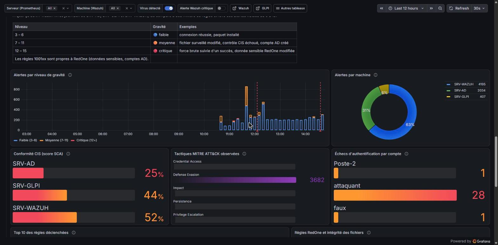
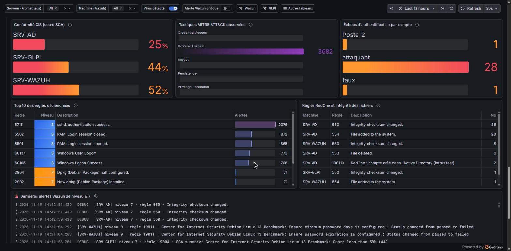
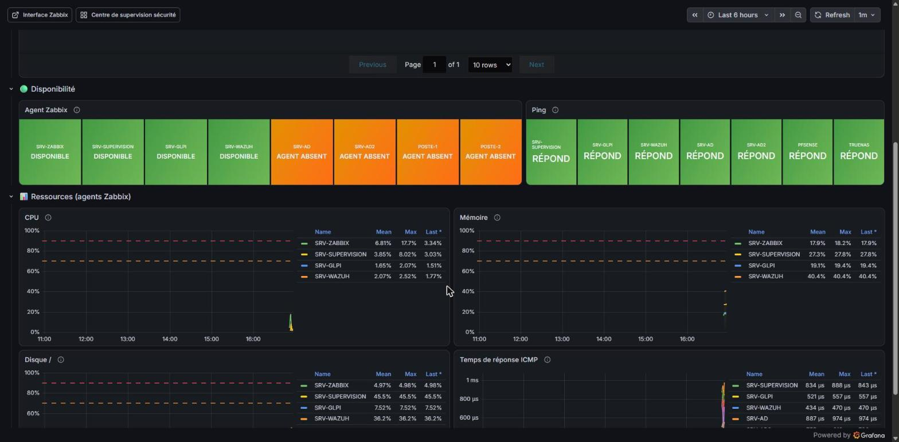
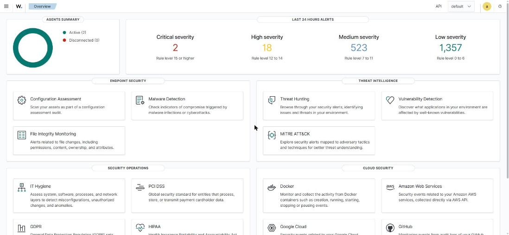
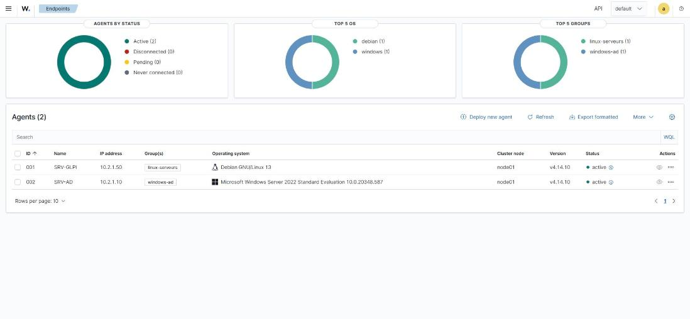
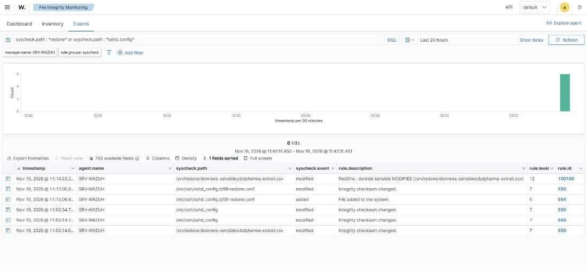
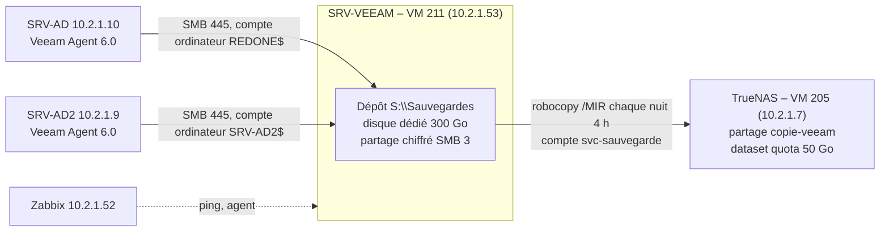

# AP2 – Exploitation et sécurité du système d'information

> **Auteur :** à compléter · **Prérequis :** [AP1](../AP1/AP1_Systeme_Information.md)

## Sommaire

1. [Objectifs](#1-objectifs)
2. [Services déployés](#2-services-déployés)
3. [Supervision – Prometheus / Grafana](#3-supervision--prometheus--grafana)
4. [Sécurité – Wazuh](#4-sécurité--wazuh)
5. [Sauvegarde et PRA](#5-sauvegarde-et-pra)
6. [RGPD](#6-rgpd)
7. [Scénario de démonstration](#7-scénario-de-démonstration)
8. [Bilan](#8-bilan)

---

## 1. Objectifs

- Superviser les serveurs et équipements réseau, avec alertes.
- Détecter les événements de sécurité (SIEM / XDR Wazuh).
- Garantir la reprise d'activité (sauvegardes Proxmox, PRA).
- Documenter la conformité RGPD des traitements.

## 2. Services déployés

| Service | IP | Rôle | État |
|---|---|---|---|
| **Prometheus + Grafana + ClamAV** (VM 204, Debian 13) | `192.168.100.204` (admin) / `10.2.1.3` (VLAN 200) | Collecte de métriques, alertes, tableaux de bord, antivirus | ✅ Opérationnel |
| **Zabbix 7.0 LTS** (VM 210 SRV-ZABBIX) | `192.168.100.210` / `10.2.1.52` | Supervision par agents, ping et scénarios web | ✅ Opérationnel |
| **Wazuh 4.14** (VM 209 SRV-WAZUH) | `192.168.100.209` / `10.2.1.51` | SIEM / XDR : détection d'intrusion, intégrité des fichiers, conformité CIS | ✅ Opérationnel |
| **Veeam Agent 6.0** + dépôt (VM 211 SRV-VEEAM) | `192.168.100.211` / `10.2.1.53` | Sauvegarde des contrôleurs de domaine, dépôt `\\SRV-VEEAM\Sauvegardes` | ✅ Installé (voir [§ 5](#5-sauvegarde-et-pra)) |
| TrueNAS SCALE 25.10 (VM 205) | `10.2.1.7` | 2ᵉ copie des sauvegardes (partage SMB `copie-veeam`) | ✅ Opérationnel |
| pfSense (VM 100, commune à la salle) | `10.2.1.1` | Pare-feu, passerelle du VLAN 200 | ✅ VLAN en place |
| GLPI 12 (VM 208 SRV-GLPI) | `192.168.100.208` / `10.2.1.50` | Gestion des incidents et du parc | ✅ Opérationnel |
| Active Directory (VM 105 REDONE, VM 206 SRV-AD2) | `10.2.1.10` / `10.2.1.9` | Annuaire `RedOne.local`, DNS (zone directe + zone inverse) | ✅ Opérationnel |

Le plan d'adressage complet et vérifié est dans l'[AP1, § 3.2](../AP1/AP1_Systeme_Information.md#32-serveurs-vlan-serveurs--17216000017).

## 3. Supervision – Prometheus / Grafana

Réponse à l'axe « Supervision et exploitation » du [cahier des charges RedOne](../CONTEXTE_RedOne.md#5-axes-dévolution-proposés) : suivre la disponibilité et les performances des serveurs, avec alertes et tableaux de bord pour la DSI.

### 3.1 Architecture



| Composant | Version | Port | Rôle |
|---|---|---|---|
| Prometheus | 2.53.3 | 9090 | Base de séries temporelles, collecte (*scrape*) et évaluation des alertes |
| node_exporter | 1.9.0 | 9100 | Expose les métriques système + les métriques ClamAV (collecteur *textfile*) |
| Grafana | 13.3.1 | 3000 | Visualisation, source de données Prometheus provisionnée |
| ClamAV | – | – | Antivirus temps réel (`clamonacc`), scan hebdomadaire de `/home` (dimanche 2 h), quarantaine dans `/var/quarantine`, base mise à jour par `freshclam` |
| Grafana Alloy | 1.21.3 | 5514/udp | Lit les 4 journaux ClamAV (avec leur horodatage réel) et reçoit les alertes Wazuh en syslog ([`config.alloy`](supervision/config.alloy)) |
| Loki | 3.7.9 | 3100 | Stockage des journaux, **persistant** dans `/var/lib/loki`, conservation 30 jours ([`loki-config.yml`](supervision/loki-config.yml)) |

### 3.2 Configuration de Prometheus

Fichiers versionnés dans [`AP2/supervision/`](supervision/) :

| Fichier sur la VM | Fichier du dépôt | Contenu |
|---|---|---|
| `/etc/prometheus/prometheus.yml` | [`prometheus.yml`](supervision/prometheus.yml) | Jobs `prometheus`, `node`, `linux`, `windows` |
| `/etc/prometheus/rules/redone-alerts.yml` | [`redone-alerts.yml`](supervision/redone-alerts.yml) | 6 règles d'alerte |
| `/etc/prometheus/targets/linux.yml` | – | Cibles Linux à ajouter (*file_sd*) |
| `/etc/prometheus/targets/windows.yml` | – | Cibles Windows à ajouter (*file_sd*) |

**Ajouter un serveur à superviser** sans redémarrer Prometheus :

```yaml
# /etc/prometheus/targets/linux.yml
- targets: ['10.2.1.50:9100']
  labels:
    host: 'srv-glpi'
```

Sur le serveur à superviser (Debian) : `apt install prometheus-node-exporter`. Pour l'AD Windows : installer [windows_exporter](https://github.com/prometheus-community/windows_exporter) et ajouter la cible `IP:9182` dans `windows.yml`.

Validation de la configuration avant chaque redémarrage :

```bash
promtool check config /etc/prometheus/prometheus.yml
systemctl restart prometheus
```

### 3.3 Hôtes supervisés

| Hôte | IP | Méthode | État |
|---|---|---|---|
| srv-supervision (VM 204) | `10.2.1.3` | node_exporter + textfile ClamAV | ✅ UP |
| Prometheus | `10.2.1.3:9090` | auto-supervision | ✅ UP |
| SRV-GLPI (VM 208) | `10.2.1.50:9100` | node_exporter (job `linux`, label `host=srv-glpi`) | ✅ UP |
| SRV-WAZUH (VM 209) | `10.2.1.51:9100` | node_exporter (job `linux`, label `host=srv-wazuh`) | ✅ UP |
| SRV-ZABBIX (VM 210) | `10.2.1.52:9100` | node_exporter (job `linux`, label `host=srv-zabbix`) | ✅ UP (ajouté le 26/11) |
| SRV-AD / SRV-AD2 | `10.2.1.10` / `10.2.1.9` | supervisés par **Zabbix** (agent Windows) – windows_exporter possible | ⏳ agent Zabbix à installer |
| pfSense | `10.2.1.1` | ping par **Zabbix** (VM commune, pas d'agent installable) | ✅ répond |

### 3.4 Règles d'alerte Prometheus

| Alerte | Expression (résumé) | Durée | Sévérité |
|---|---|---|---|
| `HoteInjoignable` | `up == 0` | 3 min | critical |
| `CPUEleve` | CPU > 90 % | 5 min | warning |
| `MemoireFaible` | RAM disponible < 10 % | 5 min | warning |
| `EspaceDisqueFaible` | espace libre < 10 % | 5 min | critical |
| `ClamAVArrete` | `clamav_up == 0` | 5 min | critical |
| `SignaturesClamAVObsoletes` | base de signatures > 48 h | 1 h | warning |

Les alertes sont visibles dans Prometheus (*Alerts*) et dans le dashboard Grafana. Évolution prévue : Alertmanager pour l'envoi par mail / Telegram.

### 3.5 Dashboards Grafana

| Dashboard | Source | Contenu |
|---|---|---|
| **RedOne – Centre de supervision sécurité** (page d'accueil) | créé pour l'AP ([`redone-soc.json`](supervision/redone-soc.json), généré par [`gen_dashboard.py`](supervision/gen_dashboard.py)) | Vue unifiée **Prometheus + ClamAV + Wazuh**, 45 panneaux commentés (détail ci-dessous) |
| RedOne – Vue d'ensemble supervision | [`redone-overview.json`](supervision/redone-overview.json) | Première version : cibles, alertes, ressources, ClamAV |
| RedOne – Serveurs Linux (Node Exporter) | dashboard communautaire *Node Exporter Full* (ID 1860) | Détail complet par serveur |
| ClamAV | existant | Métriques de l'antivirus |

Les dashboards sont **provisionnés** depuis `/var/lib/grafana/dashboards/` : ils sont recréés automatiquement au démarrage de Grafana et ne dépendent pas d'une manipulation dans l'interface. Le **Centre de supervision sécurité** est la page d'accueil de Grafana (`default_home_dashboard_path` dans `/etc/grafana/grafana.ini`).

#### Le Centre de supervision sécurité

Le dashboard est **auto-documenté**. Chaque section commence par un encadré « À quoi ça sert ? » avec les seuils. Chaque panneau a une info-bulle ⓘ : ce qu'il mesure, d'où vient la donnée et quand réagir. Le code couleur est le même partout : 🟢 normal, 🟠 à surveiller, 🔴 incident.

| Section | Source | Panneaux |
|---|---|---|
| 🚦 Vue d'ensemble | Prometheus + Loki | 8 indicateurs : serveurs en ligne, alertes Prometheus, ClamAV, protection temps réel, virus détectés, alertes Wazuh, alertes critiques, échecs d'authentification |
| 🖥️ Santé des serveurs | Prometheus | Tableau d'état (en ligne, CPU, RAM, disque, uptime), courbes CPU, RAM et disque avec seuils 70 / 90 %, trafic réseau, charge |
| 🦠 Antivirus ClamAV | Prometheus + Loki | État de clamd, clamonacc et freshclam, âge et version de la base, nombre de signatures, dernier scan hebdo, détections dans le temps, mises à jour des signatures, journal des détections |
| 🔐 Sécurité Wazuh | Loki | Alertes par gravité (faible, moyenne, critique), répartition par machine, **score de conformité CIS** par serveur, tactiques **MITRE ATT&CK**, comptes visés par des échecs de connexion, top 10 des règles, règles RedOne + intégrité des fichiers, fil des alertes de niveau ≥ 7 |
| 📣 Alertes et mode d'emploi | Prometheus | Alertes déclenchées et tableau des tests de démonstration |

Filtres en haut de page : **serveur** (Prometheus) et **machine surveillée par Wazuh**. Des **annotations** marquent les détections de virus sur toutes les courbes. Les alertes Wazuh critiques sont aussi disponibles en annotation, désactivée par défaut.

**Liaison Wazuh → Grafana** : le module `wazuh-csyslogd` du serveur Wazuh envoie les alertes de niveau ≥ 3 au format JSON vers Alloy (`10.2.1.3:5514/udp`), qui les range dans Loki. Seules deux étiquettes sont indexées (`agent`, `level`), le reste est extrait du JSON au moment de la requête. Les alertes Windows très longues sont coupées à 8 Ko par csyslogd. Les champs utiles sont donc extraits par **expression régulière** plutôt que par analyse JSON, ce qui fonctionne aussi sur un message tronqué. L'historique antérieur à la liaison a été rejoué depuis `alerts.json` avec [`wazuh-backfill.py`](wazuh/wazuh-backfill.py).

```xml
<!-- /var/ossec/etc/ossec.conf (SRV-WAZUH) + wazuh-control enable client-syslog -->
<syslog_output>
  <server>10.2.1.3</server>
  <port>5514</port>
  <level>3</level>
  <format>json</format>
</syslog_output>
```

**Corrections apportées lors de la relecture (19/11/2026)** :

| Constat | Risque | Correction |
|---|---|---|
| Loki stockait ses données dans `/tmp` (tmpfs) | **tous les journaux perdus à chaque redémarrage** | stockage dans `/var/lib/loki`, conservation 30 jours (compacteur) |
| Lignes ClamAV horodatées à l'heure de lecture | détections datées au mauvais moment | horodatage extrait de la ligne (`stage.timestamp`) |
| `clamonacc.log` et `scan-hebdo.log` non collectés | temps réel et scan hebdo invisibles | ajoutés à Alloy (droit de lecture par ACL) |
| Scan hebdo et temps réel absents des métriques | pas d'alerte possible | nouvelles métriques `clamav_onaccess_up`, `clamav_freshclam_up`, `clamav_scan_last_*` ([`clamav-metrics.sh`](supervision/clamav-metrics.sh)) |
| Wazuh non relié à Grafana | deux consoles séparées | envoi syslog JSON → Alloy → Loki |
| Loki en `log_level: debug`, télémétrie active | journaux verbeux, envoi de statistiques à l'éditeur | `info`, `analytics.reporting_enabled: false` |

**Version du moteur ClamAV** : freshclam signale que la 1.4.3 est « OUTDATED » (1.4.7 recommandée). Debian 13 ne propose pas de version plus récente, ni en stable ni en backports. Les correctifs de sécurité sont intégrés directement dans le paquet Debian, et les **signatures sont mises à jour plusieurs fois par jour**. On reste donc sur la version Debian : un paquet externe casserait l'intégration (clamonacc, freshclam, mises à jour automatiques). L'écart reste visible en orange dans le panneau « Mises à jour des signatures ».

#### Mises à jour de sécurité de SRV-SUPERVISION (19/11/2026)

| Étape | Détail |
|---|---|
| Mises à jour appliquées | 82 paquets (dont 79 correctifs `trixie-security`), Alloy 1.22.0, Loki 3.7.10, noyau **6.12.117** |
| Incident | au redémarrage, le nouveau noyau se bloquait (*RCU stall*) dans le pilote `sym53c8xx` du contrôleur disque **LSI 53C895A** émulé, le choix par défaut de Proxmox quand aucun n'est précisé |
| Correction | contrôleur passé en **VirtIO SCSI** (`qm set 204 --scsihw virtio-scsi-pci`), recommandé par Proxmox pour Linux : plus performant et compatible avec le nouveau noyau. Retour arrière possible : `--scsihw lsi` |
| Effet de bord | au démarrage, le profil DHCP « Wired connection 1 » s'était accroché à la carte `ens19` (réseau de la salle). Chaque profil NetworkManager est maintenant **lié à sa carte** : `ens18` → VLAN 200 (`10.2.1.3`), `ens19` → `admin-salle` (`192.168.100.204`, priorité 10) |
| Vérification | 7 services actifs, clamonacc actif, 40/41 requêtes du dashboard avec données, **7 090 alertes Wazuh conservées dans Loki après le redémarrage** (persistance validée) |
| Nettoyage | service `openipmi` désactivé : pas de matériel IPMI dans une VM, il était en échec à chaque démarrage |

> Leçon retenue : appliquer les mises à jour du noyau **avec un instantané Proxmox préalable** et une fenêtre de maintenance. Le pilote disque émulé compte aussi : VirtIO est le bon choix pour une VM Linux.

| Vue d'ensemble | Santé des serveurs |
|---|---|
|  |  |
| **Antivirus ClamAV** | **Sécurité Wazuh** |
|  |  |
| **Conformité CIS, MITRE ATT&CK, règles** | |
|  | |

Accès : **`http://192.168.100.204:3000`** depuis n'importe quel poste de la salle (2e carte réseau de la VM 204 sur le réseau d'administration), ou `http://10.2.1.3:3000` depuis le VLAN 200.

> **Incident du 19/11/2026** : la VM 204 (bureau GNOME) s'était mise en **veille automatique** ; Proxmox la voyait « running » mais elle ne répondait plus (Grafana, Prometheus, réseau). Correctif : redémarrage puis **désactivation définitive de la veille** (`systemctl mask sleep.target suspend.target hibernate.target …`, `logind` et `dconf` GNOME). Un serveur ne doit jamais se mettre en veille.

Captures : `captures/grafana_redone_overview.png`, `captures/prometheus_targets.png`, `captures/prometheus_alerts.png`

### 3.6 Tests de la supervision

| # | Test | Méthode | Résultat attendu | Résultat obtenu |
|---|---|---|---|---|
| 1 | Services actifs | `systemctl is-active prometheus prometheus-node-exporter grafana-server` | `active` ×3 | ✅ active ×3 (13/11/2026) |
| 2 | Configuration valide | `promtool check config` | `SUCCESS`, 6 règles | ✅ SUCCESS, 6 règles |
| 3 | Cibles collectées | Prometheus → *Status → Targets* | `node` et `prometheus` UP | ✅ 2/2 UP |
| 4 | Métriques ClamAV | requête `clamav_up` | `1` | ✅ 1 (3 642 972 signatures) |
| 5 | Grafana joignable depuis le réseau | `http://192.168.100.204:3000` depuis un poste de la salle | page de connexion | ✅ HTTP 200 |
| 5b | Supervision des autres serveurs | ajout de SRV-GLPI et SRV-WAZUH dans `targets/linux.yml` | 4 cibles UP | ✅ 4/4 UP (19/11/2026) |
| 5c | Chaîne antivirus de bout en bout | fichier de test **EICAR** (inoffensif) analysé par `clamdscan` puis supprimé | détection visible dans Grafana | ✅ « Eicar-Test-Signature FOUND » → journal clamd → Alloy → Loki → panneau « Détections (24 h) » = 1 |
| 5d | Panneaux des dashboards | contrôle de chaque requête des 3 dashboards | données présentes | ✅ Vue d'ensemble 12/12 (hors liste d'alertes vide), ClamAV 8/8, Node Exporter ≈ 257/301 par serveur (le reste : capteurs matériels absents sur VM) |
| 5e | Liaison Wazuh → Grafana | alertes du serveur Wazuh reçues dans Loki | alertes visibles par machine | ✅ 6 600 alertes (SRV-AD, SRV-GLPI, SRV-WAZUH), flux en direct |
| 5f | Centre de supervision sécurité | contrôle automatique des 41 requêtes du dashboard | données présentes | ✅ 40/41 (la seule vide est la liste des alertes Prometheus, aucune alerte active) |
| 5g | Persistance des journaux | redémarrage de Loki puis de toute la VM | données conservées | ✅ 7 090 alertes avant et après le redémarrage de la VM |
| 6 | Alerte hôte injoignable | `systemctl stop prometheus-node-exporter` puis attendre 3 min | `HoteInjoignable` *firing* | à faire en démo |
| 7 | Alerte ClamAV | `systemctl stop clamav-daemon` puis attendre 5 min | `ClamAVArrete` *firing* | à faire en démo |
| 8 | Retour à la normale | redémarrer les services | alertes résolues | à faire en démo |

### 3.7 Sauvegarde de la configuration

Avant modification, la configuration d'origine a été sauvegardée dans `/root/backup-supervision-20261113-145517/` sur la VM. Restauration : recopier `prometheus/` vers `/etc/prometheus/` puis `systemctl restart prometheus`.

### 3.8 Supervision Zabbix

Zabbix complète Prometheus. Prometheus suit des **métriques** dans le temps, alors que Zabbix fonctionne par **agents** et **déclencheurs** : il produit des « problèmes » avec une gravité, et il supervise aussi les **machines Windows** et les **équipements sans agent** (ping).

#### Serveur

| Élément | Valeur |
|---|---|
| VM | **210 SRV-ZABBIX**, pool Faaaah, Debian 13 cloud-init, 2 vCPU, 4 Go, 40 Go |
| Adresses | `192.168.100.210` (salle) / `10.2.1.52` (VLAN 200) |
| Logiciel | **Zabbix 7.0.22 LTS**, paquets **officiels Debian** (serveur PostgreSQL, interface PHP/Apache, agent 2) |
| Interface | **http://192.168.100.210/zabbix**, en français, fuseau Europe/Paris |
| Installation | [`zabbix-setup.sh`](zabbix/zabbix-setup.sh) : base PostgreSQL, mot de passe généré, PHP réglé, Apache sans numéro de version |
| Configuration | [`zabbix-config.py`](zabbix/zabbix-config.py) via l'**API JSON-RPC** (rejouable) : groupes, hôtes, modèles, scénarios web, utilisateur Grafana |

Sécurité :
- le mot de passe par défaut `Admin` / `zabbix` est **remplacé à l'installation** par un mot de passe aléatoire, conservé hors dépôt ;
- l'utilisateur **`grafana`** est en **lecture seule** et s'authentifie par **jeton d'API** ;
- sur les agents Windows, le pare-feu n'accepte le port 10050 et le ping que depuis `10.2.1.52`.

#### Hôtes supervisés

| Hôte | IP | Groupe | Méthode / modèles | État |
|---|---|---|---|---|
| SRV-ZABBIX | `127.0.0.1` | RedOne/Serveurs Linux | agent 2, *Linux by Zabbix agent*, *Zabbix server health* | ✅ disponible |
| SRV-SUPERVISION | `10.2.1.3` | RedOne/Serveurs Linux | agent 2, Linux + *ICMP Ping* | ✅ disponible |
| SRV-GLPI | `10.2.1.50` | RedOne/Serveurs Linux | agent 2, Linux + ICMP | ✅ disponible |
| SRV-WAZUH | `10.2.1.51` | RedOne/Serveurs Linux | agent 2, Linux + ICMP | ✅ disponible |
| SRV-AD / SRV-AD2 | `10.2.1.10` / `10.2.1.9` | RedOne/Serveurs Windows | agent 2, *Windows by Zabbix agent* + ICMP | ⏳ agent à installer (ping ✅) |
| SRV-VEEAM | `10.2.1.53` | RedOne/Serveurs Windows | agent 2, Windows + ICMP | ⏳ agent à installer (ping ✅) |
| POSTE-1 / POSTE-2 | `10.2.1.11` / `10.2.1.15` | RedOne/Postes de travail | agent 2, Windows | ⏳ agent à installer |
| PFSENSE | `10.2.1.1` | RedOne/Réseau et stockage | *ICMP Ping* (sans agent) | ✅ répond |
| TRUENAS | `10.2.1.7` | RedOne/Réseau et stockage | *ICMP Ping* (sans agent) | ✅ répond |

**Agents Windows** : le script [`zabbix-agent-win.ps1`](zabbix/zabbix-agent-win.ps1) est publié dans `\\RedOne.local\NETLOGON\zabbix-agent.ps1`. Il télécharge l'agent officiel, **vérifie sa signature numérique** (éditeur Zabbix), l'installe sans interaction et ouvre le pare-feu pour le seul serveur Zabbix. Il se lance en administrateur sur chaque machine :
`powershell -ExecutionPolicy Bypass -File \\RedOne.local\NETLOGON\zabbix-agent.ps1`

#### Scénarios web (disponibilité des applications)

| Scénario | URL testée | Contrôle | Déclencheur |
|---|---|---|---|
| GLPI – page de connexion | `https://10.2.1.50/` | HTTP 200 + texte « GLPI » | *GLPI indisponible* (haute) |
| Wazuh – tableau de bord | `https://10.2.1.51/` | HTTP 200 | *Wazuh indisponible* (haute) |
| Grafana – interface | `http://10.2.1.3:3000/login` | HTTP 200 + « Grafana » | *Grafana indisponible* (haute) |
| Zabbix – interface web | `http://localhost/zabbix/` | HTTP 200 + « Zabbix » | *Zabbix indisponible* (haute) |

Les modèles officiels apportent en plus leurs déclencheurs : agent injoignable, CPU élevé, mémoire faible, disque presque plein, redémarrage, ping perdu ou latence élevée, etc.

#### Liaison avec Grafana

- **Plugin** officiel *Zabbix for Grafana* (`alexanderzobnin-zabbix-app`) installé sur SRV-SUPERVISION.
- **Source de données** `Zabbix` provisionnée (`/etc/grafana/provisioning/datasources/zabbix.yaml`, fichier lisible seulement par root et Grafana) : API `http://10.2.1.52/zabbix/api_jsonrpc.php`, authentification par jeton.
- **Dashboard « RedOne – Zabbix »** ([`redone-zabbix.json`](zabbix/redone-zabbix.json), généré par [`gen_zabbix_dashboard.py`](zabbix/gen_zabbix_dashboard.py)) : problèmes actifs, état des agents et du ping par machine, CPU, mémoire, disque, latence. Chaque panneau a son info-bulle ⓘ.
- Les deux dashboards se relient entre eux par des liens en haut de page.



> Évolution prévue : envoi des notifications Zabbix par e-mail, une fois un relais SMTP disponible dans le labo.

## 4. Sécurité – Wazuh

Réponse à l'axe « Cybersécurité » du [cahier des charges RedOne](../CONTEXTE_RedOne.md#5-axes-dévolution-proposés) : détecter les incidents (SIEM) sur des données jugées stratégiques, qui « ne peuvent tolérer ni fuite, ni destruction ».

### 4.1 Serveur Wazuh

| Paramètre | Valeur |
|---|---|
| VM Proxmox | **209 – SRV-WAZUH** (pool `Faaaah`), tags `ap2`, `wazuh`, `redone` |
| Système | Debian 13, 4 vCPU, 8 Go RAM, 60 Go (`Raid5-VMs`) |
| Réseau | `eth0` `192.168.100.209/24` (administration, dashboard) – `eth1` VLAN 200 `10.2.1.51/24` (réception des agents RedOne) |
| Version | Wazuh **4.14.10**, installation tout-en-un (assistant officiel `wazuh-install.sh -a`) |
| Composants | Wazuh indexer (stockage des alertes), Wazuh manager (analyse, règles), Filebeat, Wazuh dashboard |
| Accès | `https://192.168.100.209` (compte `admin`, mot de passe conservé hors dépôt) |

| Port | Service |
|---|---|
| 443/TCP | Dashboard (HTTPS) |
| 1514/TCP | Communication agents → manager (chiffrée) |
| 1515/TCP | Enrôlement des agents (protégé par mot de passe) |
| 55000/TCP | API du manager |
| 9200/TCP | Indexer – écoute **uniquement en local** (127.0.0.1) |

### 4.2 Sécurisation et configuration

| Mesure | Détail |
|---|---|
| Enrôlement protégé | `use_password = yes` : un agent ne peut s'inscrire qu'avec le mot de passe d'enrôlement (`/var/ossec/etc/authd.pass`, droits 640) |
| Identifiants d'installation | Archive `wazuh-install-files.tar` déplacée de `/tmp` vers `/root` (droits 600) |
| FIM temps réel | `/etc/ssh`, `/etc/sudoers.d`, `/etc/passwd`, `/etc/group` et la zone de données `/srv/redone` surveillés **en temps réel**, avec historique des modifications (`report_changes`) |
| Réponse active | Blocage automatique (`firewall-drop`, 10 min) de l'IP source après brute force SSH (règle 5763) ; poste d'administration `192.168.100.141` en liste blanche |
| Journaux | Lecture de `journald` (Debian 13 n'a plus de `/var/log/auth.log`) |
| Conformité (SCA) | Audit automatique **CIS Debian Linux 13 Benchmark** |
| Vulnérabilités | Détection des vulnérabilités des paquets installés (activée par défaut) |

#### Règles personnalisées RedOne (`/var/ossec/etc/rules/local_rules.xml`)

| ID | Niveau | Déclenchement | MITRE ATT&CK |
|---|---|---|---|
| 100100 | **12** | Donnée sensible **modifiée** dans `/srv/redone` | T1565.001 (manipulation de données) |
| 100101 | **12** | Donnée sensible **supprimée** dans `/srv/redone` | T1485 (destruction de données) |
| 100102 | 10 | Nouveau fichier dans la zone de données sensibles | – |
| 100110 | 10 | Compte créé dans l'Active Directory RedOne (événement 4720) | T1136.002 |

Testé : la modification de `bdpharma-extrait.csv` lève désormais « **RedOne : donnée sensible MODIFIÉE** » en niveau 12 (au lieu de 7).

#### Groupes d'agents (configuration centralisée)

| Groupe | Cible | Configuration poussée aux agents |
|---|---|---|
| `linux-serveurs` | SRV-GLPI, SRV-SUPERVISION… | FIM temps réel (`/etc/ssh`, `/etc/shadow`, `/etc/glpi`, `/etc/apache2`, `/srv/redone`), journald, logs Apache de GLPI |
| `windows-ad` | SRV-AD, SRV-AD2 | Journaux Security, Directory Service et Windows Defender, FIM des GPO (`SYSVOL\Policies`), clés de registre Services et Run |

#### Durcissement du serveur (CIS Debian 13)

SSH (root interdit, clé uniquement, `MaxAuthTries 4`, bannière légale, `AllowUsers`), paramètres réseau du noyau (redirections, source routing, rp_filter, syncookies), ASLR, pas de core dumps, **auditd** (comptes, sudo, SSH, commandes root), durée de vie des mots de passe, droits cron.

**Score CIS : 44 % → 53 %** (99 contrôles réussis, 89 échoués, 19 non applicables), accès SSH par clé vérifié après durcissement.

### 4.3 Agents

| Machine | OS | IP | Agent |
|---|---|---|---|
| SRV-WAZUH (manager, agent 000) | Debian 13 | `10.2.1.51` | ✅ Actif (surveillance locale) |
| SRV-GLPI (VM 208) | Debian 13 | `10.2.1.50` | ✅ **Actif** – agent 001, groupe `linux-serveurs` – score CIS 43 % |
| SRV-AD (VM 105) | Windows Server 2022 | `10.2.1.10` | ✅ **Actif** – agent 002, groupe `windows-ad` – score CIS Windows Server 2022 : 25 % |
| SRV-SUPERVISION (VM 204) | Debian 13 | `10.2.1.3` | ✅ **Actif** – agent 003 (ajouté le 26/11) |
| SRV-ZABBIX (VM 210) | Debian 13 | `10.2.1.52` | ✅ **Actif** – agent 004 (ajouté le 26/11) |
| SRV-AD2, SRV-VEEAM, POSTE-1, POSTE-2 | Windows | `10.2.1.9`, `.53`, `.11`, `.15` | ⏳ agent Windows à installer |

Les agents s'inscrivent sur `10.2.1.51` avec le mot de passe d'enrôlement (`WAZUH_REGISTRATION_PASSWORD`) et reçoivent automatiquement la configuration de leur groupe. Sur SRV-AD, l'audit des **échecs** d'ouverture de session, de validation des identifiants et de gestion des comptes a été activé (`auditpol`, non tracé par défaut sur un contrôleur de domaine).

### 4.4 Cas d'usage testés (19/11/2026)

| # | Scénario | Action de test | Alerte attendue | Obtenu | ✅/❌ |
|---|---|---|---|---|---|
| 1 | Brute force SSH | 10 connexions SSH avec l'utilisateur inexistant `attaquant` depuis `192.168.100.141` | 5710 puis 5712 | **9 × 5710** (niv. 5) puis **5712** « brute force » (niv. 10), IP source identifiée | ✅ |
| 2 | Fuite / altération de données (FIM) | modification de `/srv/redone/donnees-sensibles/bdpharma-extrait.csv` | 550 | **550** « Integrity checksum changed », contenu modifié visible | ✅ |
| 3 | Modification de configuration sensible | ajout d'une ligne dans `/etc/ssh/sshd_config` | 550 | **550** sur `sshd_config` | ✅ |
| 4 | Création de compte local | `useradd intrus.test` | 5902 | **5902** « New user added » + 5901 (groupe) + 550 sur `/etc/passwd` et `/etc/group` | ✅ |
| 5 | Corrélation d'attaque | brute force suivi d'une création de compte | 40501 | **40501** « Attacks followed by the addition of an user » (**niveau 15**, maximum) | ✅ |
| 6 | Élévation de privilèges | usage de `sudo` | 5402 / 5403 | **5403** « First time user executed sudo », 5402 | ✅ |
| 7 | Conformité CIS | audit SCA automatique | Score CIS | **44 %** à l'installation, **53 %** après durcissement | ✅ |
| 8 | Attaque par mots de passe sur l'AD | 8 connexions SMB avec le compte inexistant `attaquant` sur SRV-AD | 60122 puis 60204 | **7 × 60122** « Logon Failure » (événements 4625) puis **60204** « Multiple Windows Logon Failures » (**niv. 10**) | ✅ |
| 9 | Création / suppression de compte AD | `New-ADUser intrus.test` puis `Remove-ADUser` | 100110 / 60111 | **100110** « RedOne : compte créé dans l'Active Directory (intrus.test) » (**niv. 10**, règle RedOne) puis **60111** « User account deleted » | ✅ |
| 10 | Brute force SSH sur un serveur applicatif | 10 connexions SSH `attaquant` sur SRV-GLPI | 5710 / 5712 via l'agent | **9 × 5710** puis **5712** (niv. 10), remontés par l'agent SRV-GLPI | ✅ |
| 11 | Modification de la politique d'audit | `auditpol` sur SRV-AD | 60112 | **60112** « Windows Audit Policy changed » (niv. 8) | ✅ |

### 4.5 Captures d'écran du dashboard Wazuh

| | |
|---|---|
| **Vue d'ensemble** : 2 agents actifs, alertes des dernières 24 h (2 critiques, 18 hautes) | **Agents** : SRV-GLPI (Debian 13, groupe `linux-serveurs`) et SRV-AD (Windows Server 2022, groupe `windows-ad`), version 4.14.10 |
|  |  |
| **Alertes de niveau ≥ 10** : échecs de connexion Windows multiples, brute force SSH sur GLPI, création de compte AD et donnée sensible modifiée (règles RedOne) | **Alertes critiques (niveau 15)** : « Attacks followed by the addition of an user » |
|  |  |
| **Intégrité des fichiers** : modification de `bdpharma-extrait.csv` (règle 100100, niveau 12) et de la configuration SSH | **Conformité CIS** de SRV-AD : 90 contrôles réussis, 269 échoués, score 25 % |
|  |  |
| **MITRE ATT&CK** : tactiques et techniques détectées (Valid Accounts, Brute Force, Password Guessing…) | |
|  | |

### 4.6 Pare-feux des serveurs et postes (26/11/2026)

Principe : **tout ce qui entre est bloqué, sauf les flux listés ci-dessous** ; les sorties restent autorisées. Avant cette mise en place, aucun serveur Linux n'avait de pare-feu (Prometheus `9090`, Loki `3100` et l'API Wazuh `55000` étaient joignables par toute la salle).

#### Serveurs Linux : nftables

Script [`linux-firewall.sh`](securite/linux-firewall.sh) : table `inet redone_fw` (`/etc/nftables.d/redone-firewall.nft`) chargée au démarrage par le service `redone-firewall`, politique **drop** en entrée, paquets rejetés journalisés (`nft-redone-drop:`). Application avec **retour arrière automatique au bout de 3 min** tant que l'accès n'est pas confirmé. La table `redone_gw` de SRV-GLPI (passerelle d'administration) est conservée. LLMNR et mDNS (avahi) sont désactivés.

| Serveur | Ports ouverts | Sources autorisées |
|---|---|---|
| Tous | 22/TCP SSH | poste d'admin `192.168.100.141`, Proxmox `192.168.100.2`, VLAN 200 |
| Tous | 10050/TCP agent Zabbix | SRV-ZABBIX `10.2.1.52` |
| Tous | 9100/TCP node_exporter | Prometheus `10.2.1.3` |
| Tous | ICMP (ping) | tout le monde, limité à 20/s |
| SRV-SUPERVISION | 3000/TCP Grafana | salle `192.168.100.0/24` + VLAN 200 |
| SRV-SUPERVISION | 5514 et 5515/UDP Alloy (syslog Wazuh et Veeam) | VLAN 200 |
| SRV-SUPERVISION | 9090 Prometheus, 3100 Loki | **local uniquement** (lus par Grafana sur `localhost`) |
| SRV-GLPI | 80 et 443/TCP | salle + VLAN 200 |
| SRV-WAZUH | 443/TCP dashboard | salle + VLAN 200 |
| SRV-WAZUH | 1514 et 1515/TCP agents | VLAN 200 |
| SRV-WAZUH | 55000 API, 9200 indexer | **local uniquement** |
| SRV-ZABBIX | 80/TCP interface et API | salle + VLAN 200 (dont Grafana) |
| SRV-ZABBIX | 10051/TCP trapper | VLAN 200 (scripts Veeam, agents actifs) |

#### Windows : GPO liées au domaine ([`ad-gpo-firewall.ps1`](securite/ad-gpo-firewall.ps1))

| GPO | Contenu |
|---|---|
| **RedOne - Pare-feu Windows** | pare-feu **activé sur les 3 profils** (domaine, privé, public), entrées bloquées par défaut, sorties autorisées, journal des paquets rejetés (`pfirewall.log`, 16 Mo), fusion avec les règles locales des rôles (AD DS, DNS, DHCP). Règles : **ping** depuis le VLAN 200 et le poste d'admin, **agent Zabbix 10050** depuis `10.2.1.52` uniquement, **RDP 3389** depuis le VLAN 200 et le poste d'admin |
| **RedOne - Exclusions antivirus** | exclusions Microsoft Defender recommandées par les éditeurs : dossiers Veeam (`C:\Program Files\Veeam`, `C:\ProgramData\Veeam`, `C:\Windows\Veeam`), dépôt `S:\Sauvegardes`, agents Wazuh et Zabbix, `C:\Scripts` ; processus `VeeamAgent.exe`, `Veeam.EndPoint.Service.exe`, `wazuh-agent.exe`, `zabbix_agent2.exe` ; extensions de sauvegarde `vbk`, `vib`, `vbm`, `vrb`, `vsb`, `vlb` (sinon l'analyse en temps réel ralentit et peut corrompre les sauvegardes) |

Sur **SRV-VEEAM**, le partage SMB (445) n'accepte plus que les deux contrôleurs de domaine `10.2.1.10`, `10.2.1.9` et le poste d'admin.

**ClamAV** (SRV-SUPERVISION) n'analyse en temps réel que `/home` : aucune exclusion nécessaire (les sauvegardes sont sur SRV-VEEAM). **TrueNAS** : SCALE n'a pas de pare-feu local, seuls SMB (445) et l'interface web sont exposés, et le partage `copie-veeam` exige le compte `svc-sauvegarde`. **pfSense** est une VM commune à la salle, ses règles ne sont pas modifiées.

#### Vérifications après application

| Test | Résultat |
|---|---|
| Interfaces web depuis le poste d'admin (Grafana, GLPI, Wazuh, Zabbix) | ✅ 200 / 302 |
| Prometheus `:9090` et Loki `:3100` depuis le poste d'admin | ✅ **refusés** (délai dépassé) |
| Cibles Prometheus (4 node_exporter) | ✅ toutes *up* |
| Alertes Wazuh vers Loki (syslog 5514) | ✅ 198 alertes reçues en 3 min |
| Agents Wazuh | ✅ 5 actifs |
| Ping Zabbix des 8 machines | ✅ toutes répondent |
| Données Veeam vers Zabbix (10051) | ✅ `processed: 4; failed: 0` |
| Accès des contrôleurs de domaine au dépôt `\\SRV-VEEAM\Sauvegardes` | ✅ |
| Profils pare-feu Windows (SRV-AD, SRV-AD2, SRV-VEEAM, POSTE-1) | ✅ `Domain/Private/Public = True/Block`, 3 règles RedOne, 17 exclusions Defender |

### 4.7 Pistes d'amélioration

- Remonter le score CIS (44 %) : durcissement SSH, `auditd`, partitions séparées, AIDE.
- Agents sur tous les serveurs et postes RedOne, groupes d'agents par VLAN.
- Notifications des alertes de niveau ≥ 10 par mail, et création automatique d'un ticket GLPI.
- Remplacer le certificat auto-signé du dashboard par un certificat de l'AC interne RedOne.

## 5. Sauvegarde et PRA

Réponse à l'exigence du cahier des charges : des données qui « ne peuvent tolérer ni fuite, ni destruction ». La sauvegarde suit la **règle 3-2-1** : les données de production, une sauvegarde sur un serveur dédié et une copie sur un second équipement (le NAS).

### 5.1 Architecture



### 5.2 Serveur de sauvegarde SRV-VEEAM

| Paramètre | Valeur |
|---|---|
| VM Proxmox | **211 – SRV-VEEAM** (pool `Faaaah`), tags `ap2`, `veeam`, `redone` |
| Système | Windows Server 2025 Standard, 4 vCPU, 8 Go RAM, disque système 60 Go + **disque de sauvegarde 300 Go** (`S:`, NTFS, clusters 64 Ko) |
| Réseau | `LAN-RedOne` VLAN 200 `10.2.1.53/24` (passerelle `10.2.1.1`, DNS `10.2.1.10` / `10.2.1.9`) – `Admin-Salle` `192.168.100.211/24` (non enregistrée dans le DNS) |
| Domaine | membre de `RedOne.local`, OU `Serveurs` (jonction hors ligne `djoin`, comme les postes) |
| Partage `\\SRV-VEEAM\Sauvegardes` | chiffrement SMB obligatoire, énumération basée sur l'accès ; droits **Modifier** pour les seuls comptes ordinateur `REDONE$` et `SRV-AD2$`, **Contrôle total** pour `Admins du domaine`. Aucun mot de passe n'est stocké : l'agent Veeam (service SYSTEM) s'authentifie avec le compte ordinateur du serveur |
| Partage `\\SRV-VEEAM\Logiciels$` (caché) | installeur Veeam (empreinte SHA-256 et signature Authenticode Veeam contrôlées avant chaque installation), lecture seule pour les ordinateurs du domaine |

### 5.3 Veeam Agent pour Windows

| Machine | Installation | Service |
|---|---|---|
| SRV-AD (VM 105) | silencieuse via l'agent invité Proxmox (`/silent /accepteula /acceptthirdpartylicenses`) | ✅ `VeeamEndpointBackupSvc` démarré |
| SRV-AD2 (VM 206) | **GPO** `RedOne - Installation agents serveurs (SRV-AD2)` : tâche planifiée immédiate (SYSTEM) qui lance [`srv-setup.ps1`](sauvegarde/srv-setup.ps1) depuis `NETLOGON` (agent QEMU + Veeam), filtrée sur le seul compte `SRV-AD2$` | ✅ `VeeamEndpointBackupSvc` démarré |

**Tâche de sauvegarde** (une par contrôleur de domaine) :

| Paramètre | Valeur |
|---|---|
| Mode | Ordinateur complet (*Entire computer*), état du système inclus : restauration complète (*bare metal*) ou de fichiers |
| Destination | Dossier partagé `\\SRV-VEEAM\Sauvegardes` |
| Planification | Tous les jours à **0 h 30** (la copie vers le TrueNAS suit à 4 h), sauvegarde au démarrage si l'heure a été manquée |
| Rétention | **14 jours** de points de restauration (compression optimale, blocs de 1 Mo) |
| Cohérence | traitement applicatif (VSS) : base Active Directory cohérente |

| Machine | Tâche | Première sauvegarde |
|---|---|---|
| SRV-AD | `Sauvegarde SRV-AD` | ✅ 26/11/2026 10 h 42 → 10 h 54 : **Success**, sauvegarde complète `.vbk` de **9,3 Go** (17 Go utilisés sur le disque, compression optimale), événement Veeam **190** « finished with Success » |
| SRV-AD2 | `Sauvegarde SRV-AD2` | ✅ 26/11/2026 11 h 18 → 11 h 26 : **Success**, sauvegarde complète de **7,0 Go** |

> **Limite de l'édition gratuite** : Veeam Agent *Free* refuse l'import de configuration en ligne de commande (`Veeam.Agent.Configurator.exe -import` renvoie *« This feature is unavailable in the Free edition »*). La tâche se crée donc dans la console Veeam de chaque serveur (*Configure backup*). Avec une licence *Server* ou une console Veeam Backup & Replication, elle serait déployée de façon centralisée.

### 5.4 Copie sur le TrueNAS (2ᵉ support)

| Élément | Valeur |
|---|---|
| Service | SMB activé sur le TrueNAS (port **445**), SMB1 désactivé, groupe de travail `REDONE0` |
| Dataset | `Data/sauvegardes-veeam`, compression LZ4, **quota 50 Go** |
| Partage | `copie-veeam` (masqué), accès réservé au compte local `svc-sauvegarde` (mot de passe aléatoire conservé hors dépôt) |
| Copie | tâche planifiée SYSTEM `RedOne - Copie sauvegardes vers TrueNAS` sur SRV-VEEAM, **chaque nuit à 4 h** : `robocopy S:\Sauvegardes \\truenas.redone.local\copie-veeam /MIR` |
| Traçabilité | `C:\Scripts\copie-truenas.log`, historique `copie-truenas-historique.log`, événements **1000** (réussite) / **1001** (échec) source `RedOne-Sauvegarde` dans le journal Application |
| Test (26/11/2026) | copie lancée à la main : `copie OK (robocopy 1)`, fichier présent sur le TrueNAS ✅ |

### 5.5 Supervision des sauvegardes (Zabbix, Loki, Grafana)

Veeam Agent n'a pas d'interface web : chaque serveur a sa console locale (*Veeam Agent → Control Panel*). Pour voir les sauvegardes **au même endroit que le reste**, le script [`veeam-status.ps1`](sauvegarde/veeam-status.ps1) tourne en tâche planifiée SYSTEM `RedOne - Etat Veeam vers Zabbix et Grafana` sur SRV-AD, SRV-AD2 et SRV-VEEAM (toutes les 15 min, et **dès la fin de chaque sauvegarde** sur l'événement 190). Il n'installe rien : les protocoles sont écrits en PowerShell.

| Envoi | Vers | Contenu |
|---|---|---|
| Protocole *Zabbix sender* (TCP 10051) | SRV-ZABBIX `10.2.1.52`, éléments **trapper** (hôtes autorisés : `10.2.1.10`, `.9`, `.53`) | résultat (0 succès, 1 avertissement, 2 échec, 3 aucune), âge en heures, points de restauration, taille ; espace libre du dépôt, résultat et âge de la copie TrueNAS |
| Syslog RFC 3164 (UDP **5515**) | Grafana Alloy sur SRV-SUPERVISION `10.2.1.3` → Loki, `job="veeam"`, étiquettes `host`, `type`, `resultat` | une ligne lisible par serveur, conservée 30 jours |

**Déclencheurs Zabbix** ([`zabbix-veeam.py`](sauvegarde/zabbix-veeam.py)) : sauvegarde en **échec** (haute), terminée avec avertissement, **aucune sauvegarde depuis plus de 26 h** (moyenne), état non reçu depuis 1 h, dépôt S: rempli à plus de 85 % (haute), copie TrueNAS en échec ou absente depuis 26 h. Ils apparaissent avec les autres problèmes dans Zabbix et dans Grafana.

**Grafana** : section « 💾 Sauvegardes Veeam » du dashboard *RedOne – Zabbix* : dernier résultat, âge, points de restauration et volume par serveur, espace libre du dépôt, état de la copie TrueNAS, et journal Loki des sauvegardes.


*Capture du 26/11/2026 : SRV-AD en succès (première sauvegarde 9,12 Go), SRV-AD2 en rouge tant que sa tâche n'est pas créée (le déclencheur « aucune sauvegarde » le signale aussi dans les problèmes), dépôt libre à 96,9 %, copie TrueNAS OK.*

### 5.6 Synthèse

| Élément | Méthode | Fréquence | Rétention | Testée |
|---|---|---|---|---|
| Contrôleurs de domaine (SRV-AD, SRV-AD2) | Veeam Agent → `\\SRV-VEEAM\Sauvegardes` | Quotidienne 0 h 30 | 14 jours | ✅ sauvegardes SRV-AD et SRV-AD2 réussies ; ☐ restauration à tester |
| Dépôt de sauvegarde | robocopy → TrueNAS `copie-veeam` | Quotidienne 4 h | miroir | ✅ copie testée |
| VM critiques (AD, GLPI, pfSense) | Sauvegarde Proxmox (vzdump, mode snapshot) | Quotidienne | 7 jours | ☐ |
| Configuration pfSense | Export XML (*Diagnostics → Backup & Restore*) | À chaque modification | Hors dépôt Git | ☐ |
| Base GLPI | `mysqldump` | Quotidienne | 7 jours | ☐ |

**Procédure de restauration testée :** *à compléter (restauration d'une VM depuis une sauvegarde, durée mesurée, RTO / RPO obtenus).*

## 6. RGPD

| Traitement | Données | Finalité | Durée de conservation | Accès |
|---|---|---|---|---|
| Comptes AD | nom, prénom, identifiant | Authentification | Durée de la scolarité | Administrateurs |
| GLPI | nom, matériel attribué | Gestion de parc | Durée de vie du matériel | Techniciens |
| Journaux Wazuh / Zabbix | IP, identifiants de connexion | Sécurité | 6 mois – 1 an (recommandation CNIL) | Administrateurs |

Mesures : comptes nominatifs, accès restreints par groupe AD, données de test fictives.

## 7. Scénario de démonstration

1. Présenter l'architecture (schéma réseau, VLAN).
2. Ouvrir le dashboard Grafana **RedOne – Vue d'ensemble supervision** : tout est vert.
3. Arrêter l'antivirus (`systemctl stop clamav-daemon`) → la tuile ClamAV passe à **ARRÊTÉ** → l'alerte `ClamAVArrete` se déclenche après 5 min → ouverture d'un ticket GLPI.
4. Arrêter `prometheus-node-exporter` → alerte `HoteInjoignable` → redémarrage → retour au vert.
5. Simuler un brute force SSH → alerte dans Wazuh.
6. Restaurer une VM depuis une sauvegarde Proxmox.

## 8. Bilan

*À compléter : résultats des tests, difficultés, améliorations possibles.*
