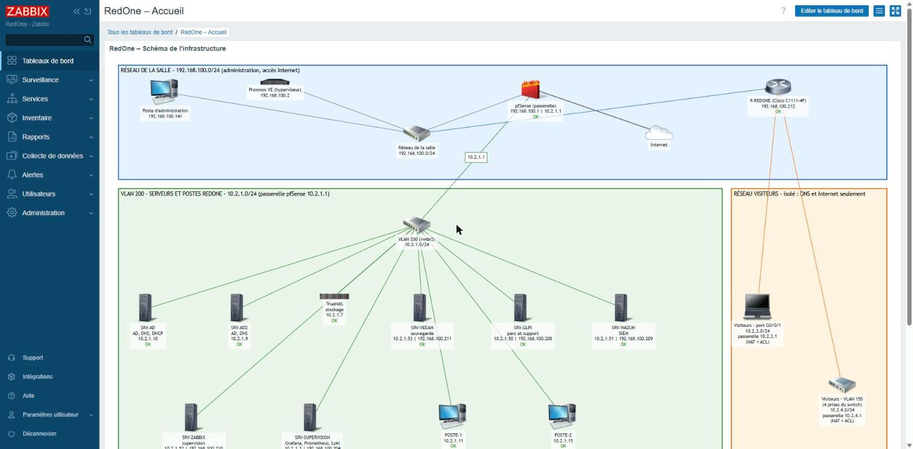

# BTS SIO SISR – Ateliers de professionnalisation RedOne

Infrastructure du **laboratoire pharmaceutique RedOne** (site pilote de Paris), réalisée sur l'hyperviseur Proxmox de la section et un routeur Cisco physique.



## Les deux ateliers

| | Problématique | Contenu |
|---|---|---|
| **[AP1 – Superviser et sécuriser](AP1-Superviser-et-securiser/README.md)** | Partant d'une infrastructure de base (un AD, deux postes), comment la rendre **maîtrisée** : surveillée, protégée, sauvegardée et conforme au RGPD ? | Active Directory et GLPI, supervision Zabbix et Grafana, SIEM Wazuh et réponse active, antivirus, pare-feux, autorité de certification, sauvegarde 3-2-1 et PRA, RGPD |
| **[AP2 – Ouvrir le réseau](AP2-Ouvrir-le-reseau/README.md)** | Le réseau est sécurisé… mais n'existe-t-il que le réseau interne ? Comment **s'ouvrir vers l'extérieur sans s'exposer** ? | Routeur Cisco sécurisé et supervisé, réseau Visiteurs isolé (DHCP, NAT, ACL), traçabilité légale des connexions, sauvegarde automatique de la configuration |

## Organisation du dépôt

```
AP1-Superviser-et-securiser/   dossier de l'AP1 (README), captures, scripts par outil
AP2-Ouvrir-le-reseau/          dossier de l'AP2 (README), captures, configuration du routeur, scripts
annexes/                       contexte RedOne, procédure PRA, conformité RGPD détaillée, veille
```

| Annexe | Contenu |
|---|---|
| [Contexte RedOne](annexes/Contexte_RedOne.md) | l'entreprise, le SI existant, le plan VLAN et les besoins du cahier des charges |
| [Procédure PRA](annexes/Procedure_PRA.md) | objectifs de reprise, rôles, ordre de redémarrage, 6 scénarios de sinistre |
| [Conformité RGPD](annexes/Conformite_RGPD.md) | registre des traitements, mesures appliquées et commandes de vérification |
| [Veille et portfolio](annexes/Veille_Portfolio.md) | veille technologique |

## Règles du dépôt

- **Aucun mot de passe, clé ou jeton** n'est versionné : les scripts lisent les secrets sur les serveurs, et les identifiants sont conservés hors dépôt.
- Les comptes et données de la maquette (dont les données de santé) sont **fictifs**.
